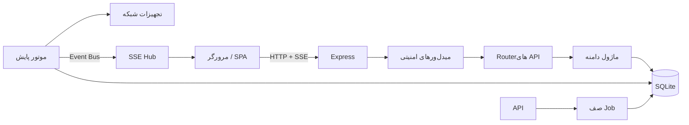
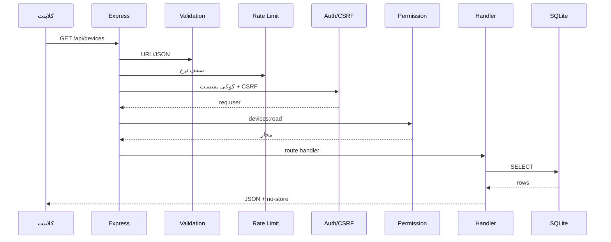
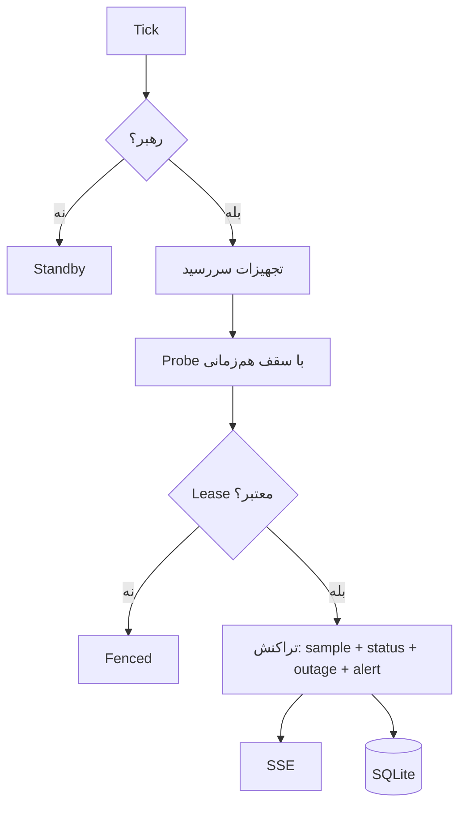

# فصل ۲ — معماری و چرخهٔ درخواست

> **خلاصه:** NetWatch یک فرآیند Node.js است که هم‌زمان API، رابط کاربری، SSE و
> موتور پایش را اجرا می‌کند. این فصل نشان می‌دهد یک درخواست از مرورگر تا
> SQLite چه مسیری را طی می‌کند و هر مسئولیت در کدام فایل است.
>
> **نرم‌افزارها:** Node.js، Express 5، SQLite داخلی، React/Vite.

---

## ۱. نمای کلی



اجزای اصلی:

| جزء | فایل | مسئولیت |
| --- | --- | --- |
| Bootstrap | `server/index.js` | ساخت Express، ترتیب میدل‌ور، اتصال Router، سلامت، SPA، shutdown |
| Config | `server/config.js` | خواندن env و اعتبارسنجی |
| DB | `server/db.js` | اتصال، PRAGMA، Schema، Migration، Transaction |
| Store | `server/store.js` | Query و سریال‌سازی داده |
| Engine | `server/engine.js` | زمان‌بندی، Probe، وضعیت، Outage، Alert |
| Leader | `server/leader.js` | قفل رهبری و Fencing |
| Auth | `server/auth.js` | Login، Session، CSRF، کاربر |
| RBAC | `server/permissions.js` | نقش و مجوز |
| SSE | `server/sse.js` | اتصال زنده و Backpressure |
| Jobs | `server/jobs.js` | کار سنگین در Worker |
| Frontend | `web/src/**` | SPA و مصرف API/SSE |

---

## ۲. ترتیب Boot

فایل `server/index.js` پیش از listen چند کار حیاتی انجام می‌دهد:

1. خواندن `config.js` و بررسی صحت env.
2. `verifyDatabaseAtStartup()` — سلامت فایل DB و کلید خارجی.
3. `markInterruptedRetentionRuns()` — بستن اجرای نیمه‌کارهٔ Retention.
4. Seed دادهٔ نمایشی فقط اگر صریحاً فعال باشد.
5. پاک‌سازی فایل‌های موقت و یتیم.
6. `pruneBrokenDiagramLinks()` برای ارجاع‌های شکسته.
7. ساخت Express و نصب میدل‌ورها.
8. اتصال Routerها و SSE.
9. اجرای موتور و Schedulerها.
10. `server.listen` روی `HOST:PORT`.

نمونهٔ واقعی شروع:

```js
const DEV = config.dev;
const PORT = config.port;
const HOST = config.host;

verifyDatabaseAtStartup();
markInterruptedRetentionRuns();
if (config.seedDemo) seedIfEmpty();
```

نکته: اگر پایگاه‌داده خراب باشد، برنامه پیش از سرو کردن درخواست متوقف
می‌شود. ادامهٔ کار روی فایل خراب، داده را بیشتر نابود می‌کند.

---

## ۳. چرخهٔ یک درخواست API



ترتیب واقعی میدل‌ورها در `server/index.js`:

```js
app.use(express.json({ limit: '2mb', strict: true }));
app.use('/api', validateRequestUrl);
app.use('/api', validateJsonBody);
app.use('/api', sameOriginOnly);
// هدرهای امنیتی، لاگ، سقف نرخ عمومی
app.use('/api', generalLimiter);
app.use('/api', attachUser);
app.use('/api', auditMutations);
app.use('/api', requireAuth, csrfGuard);
app.use('/api/auth', authRouter);
```

چند نکتهٔ کلیدی:

- `auditMutations` **پیش از** گارد مجوز است تا درخواست ردشده هم ثبت شود.
- `sameOriginOnly` فقط متدهای تغییردهنده را بررسی می‌کند؛ درخواست‌های
  غیرمرورگری که `Origin` ندارند مسدود نمی‌شوند.
- `Cache-Control: no-store` روی APIها اعمال می‌شود.
- `validateJsonBody` بدنهٔ غیرشیء، Content-Type اشتباه و کلیدهای خطرناک مثل
  `__proto__` را رد می‌کند.

---

## ۴. Router، دامنه و Store

قاعدهٔ مرزی:

```text
Router  → اعتبارسنجی ورودی، انتخاب status code، پاسخ
Domain  → منطق کسب‌وکار، تراکنش، قاعده
Store   → Query و سریال‌سازی
DB      → اتصال و Migration
```

نمونهٔ ساده از `server/routes/inventory.js`:

```js
router.get('/layers', (_req, res) => {
  const items = db.prepare('SELECT * FROM map_layers ORDER BY id').all();
  const files = mbtiles.listFiles();
  res.json({ items, files, tilesDir: path.basename(MBTILES_DIR), settings: getSettings() });
});
```

در کد واقعی، منطق پیچیده‌تر (مثل حذف فایل MBTiles) در همان Router با
تراکنش و staging انجام می‌شود؛ اما قاعده این است که Query خام در چند نقطه
پخش نشود و قواعد دامنه در یک ماژول قابل تست بمانند.

---

## ۵. جریان دادهٔ موتور



`devices.next_check_at` خودش صف است؛ صف حافظهٔ نامحدود وجود ندارد. نتیجهٔ
هر بررسی در یک تراکنش ثبت می‌شود. جزئیات کامل در فصل ۹.

---

## ۶. Frontend در معماری

- SPA در `web/src` قرار دارد و در تولید از `web/dist` سرو می‌شود.
- `web/src/lib/api.ts` تنها نقطهٔ تماس با API است.
- `web/src/lib/auth.tsx` کاربر و مجوزها را نگه می‌دارد.
- `web/src/lib/store.tsx` دادهٔ مشترک و اتصال SSE را مدیریت می‌کند.
- هر صفحه با `React.lazy` بارگذاری می‌شود تا بستهٔ اولیه کوچک بماند.

```tsx
const Dashboard = lazy(() => import('./pages/Dashboard'));
const Devices = lazy(() => import('./pages/Devices'));
```

---

## ۷. مدل‌های استقرار

| مدل | توضیح |
| --- | --- |
| تک‌فرآیندی | API + UI + Engine در یک Node process |
| سرور + Engine مستقل | `NETWATCH_ENGINE=0` برای سرور و `npm run engine` برای موتور |
| پشت Reverse Proxy | TLS در Nginx، NetWatch روی loopback |
| TLS مستقیم | `NETWATCH_TLS_DIR` یا `npm run tls:setup` |

در مدل چندفرآیندی، هر دو باید به همان `DATA_DIR` دسترسی داشته باشند و فقط
یکی رهبر می‌شود.

---

## ۸. خاموشی تمیز

هر منبع دائمی باید در shutdown آزاد شود: تایمر موتور، SSE، Job، قفل رهبری،
Scheduler پشتیبان و Retention. تست `SIGTERM` در
`server/tests/integration/lifecycle.test.mjs` (یا فایل‌های مرتبط) همین را
بررسی می‌کند.

---

## ۹. تمرین

1. در `server/index.js` ترتیب میدل‌ورها را پیدا کنید.
2. یک درخواست `GET /api/health` و یک `GET /api/devices` را با curl مقایسه
   کنید؛ کدام‌یک احراز هویت می‌خواهد؟
3. با جست‌وجو در کد، محل `requirePermission` را پیدا کنید.
4. مسیر یک نمونهٔ موتور تا SSE را روی نمودار رسم کنید.

---

## ۱۰. چک‌لیست پایان فصل

- [ ] نقش `server/index.js` و `config.js` را می‌دانم.
- [ ] ترتیب میدل‌ورهای امنیتی را می‌شناسم.
- [ ] تفاوت Router/Domain/Store را می‌فهمم.
- [ ] می‌دانم چرا `next_check_at` صف است.
- [ ] مسیر Frontend تا API را می‌شناسم.
- [ ] می‌دانم در shutdown چه منابعی باید آزاد شوند.

**فصل بعد:** [قواعد کد و خطا](03-code-conventions.md)
