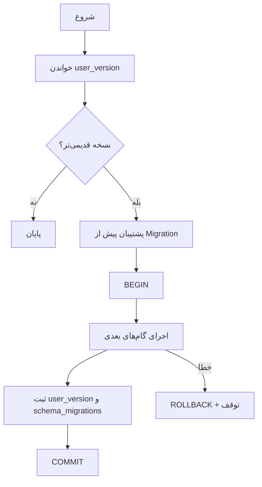

# فصل ۴ — SQLite، Migration و Transaction

> **خلاصه:** NetWatch از SQLite داخلی Node (`node:sqlite`) با WAL استفاده
> می‌کند. این فصل اتصال، PRAGMAها، Migrationها، تراکنش و Prepared Statement
> را توضیح می‌دهد و نشان می‌دهد چرا یک تغییر داده باید اتمیک باشد.
>
> **نرم‌افزارها:** `node:sqlite` (بدون سرور دیتابیس)، SQLite WAL،
> `node:test` برای آزمون.

---

## ۱. چرا SQLite؟

- **بدون سرویس جدا:** فقط یک فایل، مناسب نصب آفلاین.
- **پشتیبان‌گیری ساده:** `VACUUM INTO` و manifest.
- **تراکنش ACID:** برای Outage/Alert/Diagram حیاتی است.
- **هزینهٔ عملیاتی کم:** بدون کاربر/رمز دیتابیس.

محدودیت اصلی: نوشتن تک‌نویسنده و مقیاس افقی محدود. برای همین موتور با
`max_workers` و Batch Write طراحی شده است.

---

## ۲. اتصال و PRAGMAهای مهم

فایل `server/db.js` اتصال را می‌سازد و این تنظیمات را اعمال می‌کند:

| تنظیم | مقدار/معنی |
| --- | --- |
| `journal_mode` | `WAL` |
| `synchronous` | `FULL` (قابل تغییر با env) |
| `foreign_keys` | `ON` |
| `busy_timeout` | پیش‌فرض ۵۰۰۰ms |
| `user_version` | نسخهٔ Schema |
| `schema_migrations` | تاریخچهٔ Migration |

WAL یعنی خواندن و نوشتن هم‌زمان بهتر کار می‌کنند، اما فایل `-wal` و `-shm`
بخشی از وضعیت دیتابیس‌اند. کپی خام فایل اصلی در حال اجرا می‌تواند ناسازگار
باشد؛ برای پشتیبان از `db:backup` استفاده کنید.

---

## ۳. نسخهٔ Schema

```js
// server/db-constants.js (بازصادرشده از server/db.js)
export const SCHEMA_VERSION = 25;
```

قاعده: هر تغییر ساختاری، `SCHEMA_VERSION` را یک واحد بالا می‌برد و یک گام
idempotent به `MIGRATIONS` اضافه می‌کند.

Migration ۲۳:

```js
function applyDeviceTagReverseIndexMigration() {
  db.exec(
    'CREATE INDEX IF NOT EXISTS idx_device_tags_tag ON device_tags(tag_id, device_id)'
  );
}

const MIGRATIONS = [
  // ...
  {
    version: 23,
    name: 'device-tags-reverse-index',
    up: applyDeviceTagReverseIndexMigration,
  },
];
```

گام باید دوباره‌اجراپذیر باشد: `hasColumn` و `IF NOT EXISTS` ابزارهای اصلی‌اند.

---

## ۴. چرخهٔ Migration



نکات:

- پیش از Migration روی دیتابیس موجود، یک فایل
  `netwatch.db.pre-migration-v<old>-<timestamp>` ساخته می‌شود.
- اگر پشتیبان ساخته نشود، Migration انجام نمی‌شود.
- شکست هر گام، کل Migration را Rollback می‌کند.
- پس از Migration، `verifyDatabaseAtStartup()` سلامت را بررسی می‌کند.

---

## ۵. Transaction امن

پیاده‌سازی `DatabaseHandle.transaction`:

```js
transaction(fn, { immediate = true, label = 'tx' } = {}) {
  const outer = this.txDepth === 0;
  const savepoint = `nw_sp_${++txSeq}`;
  this.raw.exec(outer ? 'BEGIN IMMEDIATE' : `SAVEPOINT ${savepoint}`);
  this.txDepth++;
  try {
    const result = fn();
    if (result && typeof result.then === 'function') {
      throw new DbError(DB_ERROR_CODES.BINDING, 'تراکنش باید همگام باشد...');
    }
    this.txDepth--;
    this.raw.exec(outer ? 'COMMIT' : `RELEASE ${savepoint}`);
    return result;
  } catch (err) {
    this.txDepth = Math.max(0, this.txDepth - 1);
    // ROLLBACK یا ROLLBACK TO SAVEPOINT
    throw err;
  }
}
```

### قواعد استفاده

1. تابع را **همگام** نگه دارید.
2. داخل transaction کار شبکه/IO طولانی انجام ندهید.
3. عملیات مرتبط (رکورد + فایل + Revision) را در یک transaction بگذارید.
4. برای عملیات تودرتو از Savepoint خودکار استفاده کنید.
5. خطا را دوباره throw کنید تا Rollback انجام شود.

### مثال واقعی: حذف دیاگرام

```js
cleanup = transaction(
  () => {
    db.prepare(`DELETE FROM diagrams WHERE id IN (${placeholders})`).run(...ids);
    return cleanupDiagramReferences(idSet);
  },
  { label: 'diagram.delete' }
);
```

فایل‌های پیوست پیش از transaction stage می‌شوند و در خطا نامشان برمی‌گردد.
این الگو در فصل ۱۱ هم تکرار می‌شود.

---

## ۶. Prepared Statement

هر مقدار کاربر باید پارامتر باشد:

```js
db.prepare('SELECT * FROM devices WHERE id = ?').get(deviceId);
db.prepare(
  'SELECT * FROM samples WHERE device_id = ? AND ts >= ? ORDER BY ts DESC LIMIT ?'
).all(deviceId, since, limit);
```

هرگز این کار را نکنید:

```js
// خطر: تزریق SQL
db.prepare(`SELECT * FROM devices WHERE name = '${name}'`);
```

برای ستون مرتب‌سازی، نام را از یک فهرست بسته انتخاب کنید؛ نه از ورودی خام.
`parseListQuery` در `store.js` همین کار را می‌کند.

---

## ۷. WAL و Checkpoint

- Checkpoint محتوای WAL را به فایل اصلی منتقل می‌کند.
- پیش از Backup، `TRUNCATE` checkpoint اجرا می‌شود.
- WAL بسیار بزرگ نشانهٔ نوشتن سنگین یا Checkpoint ناموفق است.
- `db.walInfo()` برای سلامت و صفحهٔ AppHealth استفاده می‌شود.

```bash
npm run db:doctor
```

---

## ۸. آزمون Migration

```bash
env -u PORT node --test server/tests/unit/db-migration.test.mjs server/tests/unit/db-migration-atomicity.test.mjs
env -u PORT npm run test:integration
```

آزمون‌های مرتبط:

- `server/tests/unit/db-migration.test.mjs`
- `server/tests/integration/upgrade-and-install.test.mjs`
- `server/tests/integration/db-stability.test.mjs`

برای Migration جدید:

1. `SCHEMA_VERSION` را افزایش دهید.
2. گام idempotent بنویسید.
3. آزمون ارتقا از نسخهٔ قبل و نصب تازه اضافه کنید.
4. مستندات `database.md` و Changelog را به‌روز کنید.

---

## ۹. تمرین

1. `SCHEMA_VERSION` و Migration ۲۳ را پیدا کنید.
2. یک ستون تازه به‌صورت فرضی طراحی کنید و گام idempotent آن را بنویسید.
3. یک Query با پارامتر و یک Query ناامن را مقایسه کنید.
4. `npm run db:doctor` را اجرا و خروجی آن را تفسیر کنید.

---

## ۱۰. چک‌لیست پایان فصل

- [ ] WAL و فایل‌های `-wal/-shm` را می‌شناسم.
- [ ] می‌دانم Migration چرا idempotent است.
- [ ] transaction همگام و Rollback را می‌فهمم.
- [ ] Prepared Statement را در همهٔ Queryها استفاده می‌کنم.
- [ ] Checkpoint و Backup را از کپی خام فایل تفکیک می‌کنم.
- [ ] آزمون Migration را می‌شناسم.

**فصل بعد:** [Schema، Query و Index](05-schema-queries-indexes.md)
