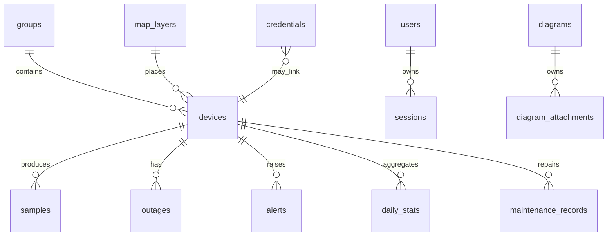

# فصل ۵ — Schema، Query و Index

> **خلاصه:** این فصل مدل دادهٔ NetWatch را از دید توسعه‌دهنده توضیح می‌دهد:
> جدول‌های اصلی، روابط، فیلترها، صفحه‌بندی، ایندکس و نحوهٔ خواندن
> `EXPLAIN QUERY PLAN`. هدف این است که Query تازه، کند یا ناامن نباشد.
>
> **نرم‌افزارها:** SQLite، `EXPLAIN QUERY PLAN`، `node:test`، ابزار
> `db:doctor`.

---

## ۱. جدول‌های اصلی

### تجهیزات و پایش

| جدول | نقش | نکته |
| --- | --- | --- |
| `devices` | تجهیز و آخرین وضعیت | `next_check_at` صف بررسی |
| `samples` | نتیجهٔ هر Probe | یکتایی `(device_id, started_at)` |
| `outages` | بازهٔ قطعی | `open` و `duration_sec` |
| `alerts` | هشدارها | `active/acknowledged/resolved/suppressed` |
| `alert_rules` | قواعد هشدار | `metric`, `cooldown_sec`, `duration_sec` |
| `daily_stats` | تجمیع روزانه | مبنای گزارش بلندمدت |
| `maintenance_records` | سوابق تعمیر | اتصال اختیاری به `outage_id` |
| `maintenance_windows` | پنجرهٔ تعمیر | سرکوب هشدار |

### سازمان، نقشه و عملیات

`groups`، `tags`، `device_tags`، `map_layers`، `map_markers`،
`marker_types`، `settings`، `audit_log`، `engine_log`.

### زیرساخت

`users`، `sessions`، `credentials`، `sites`، `device_attachments`،
`device_types`، `device_templates`، `device_group_members`، `engine_lock`،
`engine_meta`، `retention_runs`، `retention_state`، `runtime_state`،
`schema_migrations`.

فایل‌های MBTiles بیرون از DB و در `<DATA_DIR>/mbtiles` هستند.

---

## ۲. روابط اصلی



قواعد:

- کلید خارجی فعال است.
- حذف گروه/تجهیز با `CASCADE` یا `SET NULL` سیاست مشخص دارد.
- رکورد یتیم نباید باقی بماند؛ اما فایل یتیم ممکن است در Startup پاک شود.

---

## ۳. Query فهرست تجهیزات

`server/store.js` فیلترها را می‌سازد و همهٔ مقادیر را پارامتر می‌کند:

```js
export function buildDeviceWhere(f, { forceEnabled = null } = {}) {
  const where = [];
  const params = [];

  if (f.search) {
    where.push(
      '(d.name LIKE ? OR d.ip LIKE ? OR d.hostname LIKE ? OR d.location LIKE ?)'
    );
    const s = `%${f.search}%`;
    params.push(s, s, s, s);
  }
  if (f.status === 'online') {
    where.push("d.status IN ('online','warning')");
  } else if (f.status) {
    where.push('d.status = ?');
    params.push(f.status);
  }
  return {
    clause: where.length ? `WHERE ${where.join(' AND ')}` : '',
    params,
  };
}
```

نکات:

- `online` در فیلتر شامل `warning` هم هست تا با KPI داشبورد یکی باشد.
- `search` روی چند ستون اجرا می‌شود؛ برای جدول بزرگ، ایندکس مناسب یا
  جست‌وجوی محدودتر لازم است.
- `sort` از `DEVICE_SORTS` انتخاب می‌شود، نه از ورودی خام.

---

## ۴. صفحه‌بندی و محدودیت

```js
const page = Math.max(1, parseInt(q.page || '1', 10) || 1);
const pageSize = Math.min(500, Math.max(1, parseInt(q.pageSize || '24', 10) || 24));
```

قواعد:

1. سقف `pageSize` داشته باشید.
2. `LIMIT/OFFSET` را با مقدار عددی و پارامتر اجرا کنید.
3. برای فهرست‌های بزرگ، `COUNT(*)` جدا و بهینه بگیرید.
4. `page` منفی یا `NaN` را به مقدار پیش‌فرض برگردانید.

---

## ۵. ایندکس‌های مهم

| ایندکس | کاربرد |
| --- | --- |
| `idx_devices_due` | انتخاب تجهیزات سررسیدشده |
| `idx_samples_device_ts` | سری زمانی یک تجهیز |
| `idx_samples_device_ok` | شمارش Uptime |
| `idx_outages_open` | قطعی باز یک تجهیز |
| `idx_alerts_duplicate` | ضدتکرار هشدار |
| `idx_audit_ts` | فهرست حسابرسی |
| `idx_sessions_expires` | پاک‌سازی نشست |
| `idx_devices_ip` | یکتایی IP |
| `idx_device_tags_tag` | تجهیزات یک تگ و `EXISTS` فیلتر تگ |

```sql
CREATE INDEX IF NOT EXISTS idx_devices_due
  ON devices(enabled, monitoring_enabled, next_check_at);

CREATE UNIQUE INDEX IF NOT EXISTS idx_outages_open
  ON outages(device_id) WHERE open = 1;
```

قیود جزئی (Partial Index) برای «یک قطعی باز» و «یک نمونهٔ عملیات» بسیار
مهم‌اند.

---

## ۶. Query Plan

```js
const plan = db
  .prepare(`EXPLAIN QUERY PLAN ${sql}`)
  .all(...params)
  .map((r) => String(r.detail));
```

قاعدهٔ پذیرش پروژه: Queryهای داغ روی جدول بزرگ نباید `SCAN table` بدون
`USING INDEX` داشته باشند. آزمون:
`server/tests/unit/db-query-plan.test.mjs`.

نمونهٔ علائم:

- `SCAN samples` → بد؛ باید `SEARCH samples USING INDEX ...` باشد.
- `USE TEMP B-TREE FOR GROUP BY` همیشه بد نیست، اما برای Query داغ باید
  بررسی شود.
- `COVERING INDEX` یعنی داده از خود ایندکس خوانده می‌شود.
- پس از Migration ۲۳، پرس‌وجوی معکوس تگ باید
  `SEARCH dt USING COVERING INDEX idx_device_tags_tag (tag_id=?)` بدهد؛
  `SCAN device_tags` نشانهٔ نبود ایندکس مناسب است.

---

## ۷. تجمیع روزانه

`daily_stats` برای گزارش‌های بلندمدت است؛ خواندن مستقیم میلیون‌ها `samples`
برای گزارش ۹۰ روزه کند است. Rollup روزانه از نمونه‌ها و قطعی‌ها پر می‌شود و
Retention می‌تواند نمونه‌های قدیمی را حذف کند بدون از دست دادن گزارش روزانه.

```sql
SELECT COUNT(*) AS checks,
       SUM(CASE WHEN ok = 1 THEN 1 ELSE 0 END) AS ok_count,
       AVG(CASE WHEN ok = 1 THEN rtt_ms END) AS avg_rtt
FROM samples
WHERE device_id = ? AND ts >= ? AND ts < ?;
```

---

## ۸. دادهٔ یتیم و یکپارچگی

- `foreign_keys=ON` از ارجاع به رکورد ناموجود جلوگیری می‌کند.
- حذف دیاگرام باید ارجاع‌های بوم‌های دیگر را هم پاک کند (فصل ۱۱).
- حذف لایهٔ MBTiles نباید رکورد بدون فایل بسازد.
- `checkDatabaseHealth({ full: true })` شامل `foreign_key_check` است.

---

## ۹. تمرین

1. برای فیلتر `status=online` توضیح دهید چرا `warning` هم برگردانده می‌شود.
2. یک Query داغ را با `EXPLAIN QUERY PLAN` اجرا کنید.
3. یک ایندکس پیشنهادی برای `alerts` طراحی کنید و هزینهٔ آن را بنویسید.
4. `db:doctor` را اجرا و تعداد جدول/ایندکس را بررسی کنید.

---

## ۱۰. چک‌لیست پایان فصل

- [ ] جدول‌های اصلی و نقش آن‌ها را می‌دانم.
- [ ] فیلترها را با پارامتر می‌سازم.
- [ ] سقف صفحه‌بندی را رعایت می‌کنم.
- [ ] ایندکس مناسب برای Query داغ انتخاب می‌کنم.
- [ ] `EXPLAIN QUERY PLAN` را می‌خوانم.
- [ ] تفاوت `samples` و `daily_stats` را می‌فهمم.

**فصل بعد:** [Store، Validation و Audit](06-domain-store-validation.md)
