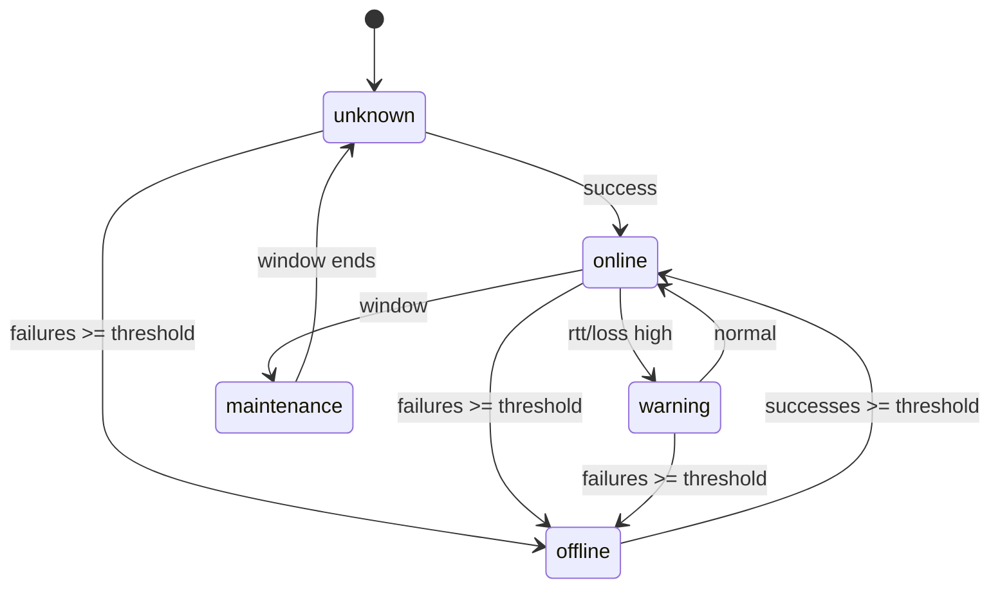
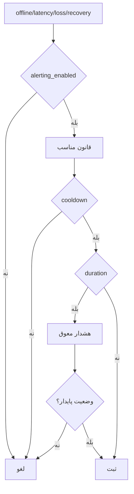

# فصل ۹ — موتور پایش

> **خلاصه:** موتور، قلب NetWatch است: تجهیزات سررسیدشده را انتخاب می‌کند،
> Probe را با سقف هم‌زمانی اجرا می‌کند، وضعیت را با هیسترزیس تغییر می‌دهد،
> قطعی/هشدار می‌سازد و نتیجه را اتمیک ثبت می‌کند. این فصل هم مفاهیم و هم
> کد واقعی را پوشش می‌دهد.
>
> **نرم‌افزارها:** `server/engine.js`، `server/ping.js`،
> `server/probe-queue.js`، `server/leader.js`، SQLite.

---

## ۱. حالت‌های Probe

| حالت | رفتار | نیازمندی |
| --- | --- | --- |
| `auto` | ICMP اگر ممکن باشد، وگرنه TCP | ابزار `ping`/مجوز |
| `icmp` | Ping واقعی | `CAP_NET_RAW` یا مجوز سیستم |
| `tcp` | اتصال به `tcp_port` | دسترسی شبکه |
| `simulate` | دادهٔ ساختگی برای دمو | هیچ |

`simulate` هرگز به‌صورت پنهان انتخاب نمی‌شود؛ باید صریح باشد.

---

## ۲. صف زمان‌بندی

`devices.next_check_at` صف است:

```sql
SELECT * FROM devices
WHERE enabled = 1 AND monitoring_enabled = 1 AND next_check_at <= ?
ORDER BY CASE priority
  WHEN 'critical' THEN 0
  WHEN 'high' THEN 1
  WHEN 'normal' THEN 2
  ELSE 3
END
LIMIT ?;
```

مزایا:

- صف حافظهٔ نامحدود نداریم.
- ایندکس `idx_devices_due` از Full Scan جلوگیری می‌کند.
- پس از Crash، وضعیت صف از DB بازیابی می‌شود.

هنگام شروع بررسی:

```js
const startedAt = monotonicNow();
const scheduledAt = Number(device.next_check_at) || 0;
const dueBase = Math.max(scheduledAt, startedAt);
S().scheduleNext.run(dueBase + interval, device.id);
```

مبنا `scheduledAt` است تا بازهٔ واقعی به‌مرور کوتاه نشود.

---

## ۳. وضعیت‌ها و هیسترزیس

| وضعیت | معنی |
| --- | --- |
| `online` | پاسخ موفق و زیر آستانه |
| `warning` | پاسخ موفق اما RTT/Loss بالا |
| `offline` | شکست متوالی به آستانه رسیده |
| `maintenance` | پنجرهٔ تعمیر |
| `unknown` | هنوز بررسی نشده |



آستانه‌های پیش‌فرض:

| کلید | پیش‌فرض |
| --- | ---: |
| `timeout_ms` | 1200 |
| `retries` | 1 |
| `packet_count` | 3 |
| `latency_threshold` | 150ms |
| `loss_threshold` | 10% |
| `failures_for_offline` | 3 |
| `successes_for_online` | 2 |

هیسترزیس جلوی نوسان یک‌بسته‌ای را می‌گیرد.

---

## ۴. Probe و تفکیک سرویس

نتیجهٔ Probe سه مفهوم دارد:

| فیلد | معنی |
| --- | --- |
| `ok` | هدف پایش پاسخ داد |
| `reachable` | میزبان در سطح شبکه پاسخ داد (حتی RST) |
| `service` | `available/unavailable/unknown` |

مثال TCP:

- پورت باز → `ok=true, reachable=true, service=available`.
- پورت بسته با RST → `ok=false, reachable=true, service=unavailable`.
- بی‌پاسخ کامل → `ok=false, reachable=false, service=unknown`.

حالت دوم در UI «سرویس قطع» است، نه لزوماً «شبکه قطع».

---

## ۵. ثبت اتمیک

```js
const payload = await this._record(() => {
  this.assertLeaseValid(lease);
  // گذار وضعیت، outage، alert، sample و updateDevice
  S().insertSample.run(/* ... */);
  S().updateDevice.run(/* ... */);
});
```

اگر هر مرحله شکست بخورد، همهٔ تغییرات آن بررسی Rollback می‌شوند. خطای
داخلی Probe نباید شمارندهٔ شکست تجهیز را بالا ببرد؛ برای همین خطاهای لایهٔ
Probe از خطای «بی‌پاسخی» جدا شده‌اند.

### برخورد زمانی نمونه

قید یکتای `(device_id, started_at)` جلوی نمونهٔ تکراری را می‌گیرد. دو بررسی
دستی سریع می‌توانند همان میلی‌ثانیه را بگیرند؛ کد با انتخاب
`max(startedAt, previous + 1)` و retry محدود، نتیجه را از دست نمی‌دهد.

---

## ۶. Outage

- ورود به `offline` → یک ردیف `outages` با `open=1`.
- بازگشت به `online` → بستن همان ردیف و محاسبهٔ `duration_sec`.
- ایندکس یکتای جزئی تضمین می‌کند هر تجهیز حداکثر یک قطعی باز داشته باشد.
- پس از Crash، قطعی باز «به فرزندی گرفته می‌شود» و ارجاع شکسته پاک می‌شود.

---

## ۷. Alert



- Cooldown از هشدار تکراری جلوگیری می‌کند.
- `duration_sec`/`alert_delay` یعنی «چند ثانیه صبر کن».
- ساعات سکوت هشدار را `suppressed` می‌کند.
- هشدارهای فعال با بازگشت وضعیت حل می‌شوند.

---

## ۸. رهبری و Fencing

اگر دو موتور هم‌زمان اجرا شوند، هر تجهیز دو بار Probe می‌شود. راه‌حل:

- جدول `engine_lock` با `owner`, `expires_at`, `epoch`.
- `BEGIN IMMEDIATE` برای گرفتن قفل.
- TTL و Retry قابل تنظیم.
- قبل از هر نوشتن، Lease/Epoch بررسی می‌شود.
- اگر رهبری عوض شده باشد، نتیجه `Fenced` و دور ریخته می‌شود.

```js
if (!this.isLeaseValid(lease)) {
  this.noteFenced(lease, device.id, 'after-probe');
  return null;
}
```

---

## ۹. Rollup و Retention

- Rollup تقریباً هر ۵ دقیقه `daily_stats` را پر می‌کند.
- Retention نمونه‌های قدیمی را حذف می‌کند، اما خلاصهٔ روزانه می‌ماند.
- Checkpoint و WAL در فصل ۱۶ بررسی می‌شوند.

---

## ۱۰. آزمون موتور

```bash
env -u PORT node --test server/tests/unit/engine-*.test.mjs
env -u PORT node --experimental-strip-types --test server/tests/integration/engine-*.test.mjs
```

آزمون‌ها:

- `engine-detection.test.mjs`: آستانه، سرویس، Alert.
- `engine-flap.test.mjs`: پنج چرخهٔ قطع/وصل.
- `leader.test.mjs`: قفل و Fencing.
- تست‌های Integration موتور با سرور واقعی.

الگوی تست:

```js
const eng = new MonitoringEngine({ emitToBus: false });
eng.probe = async () => probeResult(false);
for (let i = 0; i < 3; i++) {
  await eng.checkDevice(deviceRow(db, id), { manual: true });
}
assert.equal(deviceRow(db, id).status, STATUS.OFFLINE);
```

---

## ۱۱. تمرین

1. یک تجهیز با `failures_for_offline=3` بسازید و گذار را دنبال کنید.
2. حالت TCP با پورت بسته را از پورت باز تفکیک کنید.
3. یک هشدار با Cooldown طراحی کنید.
4. توضیح دهید چرا دو موتور هم‌زمان بدون Fencing خطرناک است.

---

## ۱۲. چک‌لیست پایان فصل

- [ ] حالت‌های Probe را می‌شناسم.
- [ ] `next_check_at` و ایندکس آن را می‌فهمم.
- [ ] هیسترزیس و آستانه‌ها را می‌دانم.
- [ ] تفاوت `ok/reachable/service` را می‌فهمم.
- [ ] ثبت اتمیک و Outage را می‌شناسم.
- [ ] Fencing و Lease را می‌فهمم.
- [ ] برای تغییر موتور تست می‌نویسم.

**فصل بعد:** [SSE و ارتباط زنده](10-sse-realtime.md)
