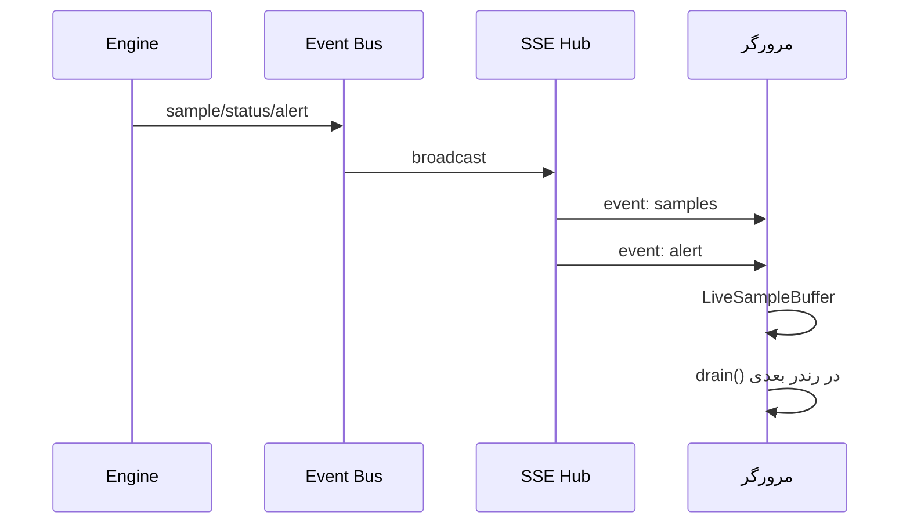

# فصل ۱۰ — SSE و ارتباط زنده

> **خلاصه:** داشبورد باید بدون Refresh به‌روز شود، اما ارسال همهٔ نمونه‌ها
> به همهٔ کلاینت‌ها حافظه و پهنای باند را می‌بلعد. این فصل SSE، اشتراک
> هر کلاینت، Backpressure، Heartbeat و Reconnect را توضیح می‌دهد.
>
> **نرم‌افزارها:** `server/sse.js`، `EventEmitter` داخلی Node،
> `EventSource` مرورگر، React Store.

---

## ۱. چرا SSE و نه WebSocket؟

- یک‌طرفه از سرور به مرورگر کافی است.
- با HTTP/Express ساده‌تر است.
- Reconnect خودکار در `EventSource` وجود دارد.
- برای اتصال پشت Proxy فقط `buffering off` لازم است.

WebSocket برای multiplayer/دوطرفه استفاده نمی‌شود.

---

## ۲. معماری



`server/index.js`:

```js
const sse = createSseHub();

app.get('/api/events', requirePermission('dashboard:read'), (req, res) => {
  const client = sse.add(req, res, {
    ts: Date.now(),
    engine: engine.getStatus(),
  });
  if (!client) {
    return res.status(503).setHeader('Retry-After', '10').json({
      error: 'ظرفیت اتصال‌های زنده پر است.',
    });
  }
});
```

---

## ۳. قالب فریم

```text
event: samples
data: [{"deviceId":12,"ts":...,"rtt":5,"ok":true}]

```

Heartbeat:

```text
: ping

```

Heartbeat از قطع‌شدن اتصال توسط Proxy در مدت بی‌رویدادی جلوگیری می‌کند.

---

## ۴. سقف‌ها

| تنظیم | پیش‌فرض | معنی |
| --- | ---: | --- |
| `NETWATCH_SSE_MAX` | 200 | حداکثر کلاینت |
| `NETWATCH_SSE_MAX_BUFFER` | 1MB | بافر هر کلاینت |
| `NETWATCH_SSE_HEARTBEAT_MS` | 25000 | فاصلهٔ Heartbeat |

مجموع حافظهٔ SSE تقریباً `maxClients × maxBuffer` است؛ هر دو را با هم
تنظیم کنید.

---

## ۵. اشتراک هر کلاینت

`?devices=1,2,3` تعیین می‌کند کلاینت چه تجهیزاتی را می‌بیند:

```js
function parseWatch(req) {
  const raw = req?.query?.devices;
  if (raw === undefined) return null; // همه
  const ids = String(raw)
    .split(',')
    .map(Number)
    .filter((n) => Number.isInteger(n) && n > 0)
    .slice(0, 500);
  return { set: new Set(ids), key: ids.sort((a, b) => a - b).join(',') };
}
```

- `devices` غایب → همهٔ رویدادها (سازگاری با کلاینت قدیمی).
- `devices=` خالی → هیچ نمونه‌ای.
- فهرست عددی → فقط همان تجهیزات.

این فیلتر جلوی ارسال هزاران نمونه به هر داشبورد را می‌گیرد.

---

## ۶. Backpressure

```js
function send(client, payload, { critical = false } = {}) {
  if (client.backpressured && !critical) {
    client.skipped += 1;
    stats.skippedFrames += 1;
    return false;
  }
  const ok = client.res.write(payload) !== false;
  client.backpressured = !ok;
  if (!ok && client.res.writableLength > maxBufferedBytes) {
    remove(client, 'buffer_limit');
  }
  return true;
}
```

رفتار:

- فریم عادی (sample/status) برای کلاینت کند حذف می‌شود.
- فریم حیاتی (alert) تلاش می‌شود.
- اگر بافر از سقف بگذرد، کلاینت قطع می‌شود.
- `drain` وضعیت backpressure را برمی‌گرداند.

---

## ۷. سمت مرورگر

`web/src/lib/live-core.ts` منطق خالص را نگه می‌دارد:

- برای هر تجهیز فقط **آخرین** نمونه.
- سقف تعداد تجهیزات بافرشده.
- `drain()` نمونه‌های تازه را برمی‌گرداند.

این طراحی از انباشت هزاران فریم تکراری بین دو رندر جلوگیری می‌کند.

```ts
const buf = new LiveSampleBuffer();
// در event:
buf.push(sample);
// در رندر:
const fresh = buf.drain();
```

---

## ۸. Reconnect

`EventSource` به‌طور خودکار دوباره وصل می‌شود. UI باید:

- وضعیت «متصل/قطع/تلاش دوباره» را نشان دهد.
- داده کهنه را با `Freshness` علامت بزند.
- پس از Reconnect، `hello` و Snapshot را دوباره بگیرد.
- خطای 401 را به Login هدایت کند.

---

## ۹. آزمون SSE

```bash
env -u PORT node --experimental-strip-types --test server/tests/integration/sse-*.test.mjs
```

سناریوها:

- ۱۰۰ کلاینت هم‌زمان `hello` بگیرند.
- همه پس از قطع، از `sse.clients` حذف شوند.
- کلاینت کند قطع شود و حافظه رشد بی‌مرز نکند.
- Reconnect دوباره `hello` بگیرد.

> تست RSS در macOS با `ps` و در Linux با `/proc` انجام می‌شود.

---

## ۱۰. تمرین

1. یک رویداد تازه به Bus اضافه کنید و مسیر آن تا SSE را دنبال کنید.
2. یک کلاینت با `?devices=1,2` بسازید و بررسی کنید فقط همان‌ها بیایند.
3. رفتار Backpressure را با یک کلاینت کند شبیه‌سازی کنید.
4. تفاوت داده کهنه و قطع اتصال را در UI توضیح دهید.

---

## ۱۱. چک‌لیست پایان فصل

- [ ] چرا SSE را انتخاب کرده‌ایم.
- [ ] قالب فریم و Heartbeat را می‌دانم.
- [ ] سقف کلاینت و بافر را می‌شناسم.
- [ ] اشتراک هر کلاینت را می‌فهمم.
- [ ] Backpressure و قطع کلاینت کند را می‌دانم.
- [ ] Reconnect و Stale Data را مدیریت می‌کنم.

**فصل بعد:** [Backup، Restore و فایل‌ها](11-backup-restore-files.md)
