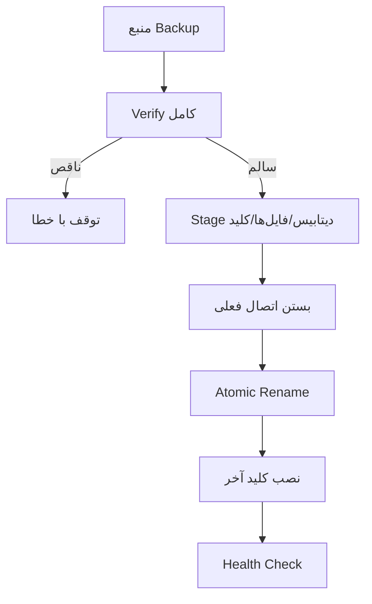

# فصل ۱۱ — Backup، Restore، فایل‌ها و تراکنش دیاگرام

> **خلاصه:** داده فقط در SQLite نیست: MBTiles، پیوست‌ها و کلید رمزنگاری هم
> بخشی از وضعیت بازیابی‌شدنی‌اند. این فصل Backup/Manifest/Checksum،
> Restore روی DATA_DIR خالی، حذف اتمیک فایل و تراکنش‌های دیاگرام را توضیح
> می‌دهد.
>
> **نرم‌افزارها:** `server/backup.js`، `node:fs`، SHA-256، SQLite
> `VACUUM INTO`، `server/routes/inventory.js`، `server/routes/diagrams.js`.

---

## ۱. اجزای یک Backup کامل

```text
backups/<name>/
├── manifest.json
├── netwatch.db
├── mbtiles/*.mbtiles
├── attachments/*
└── secrets/device-credentials.key
```

Manifest شامل:

- نسخهٔ برنامه و Schema؛
- اندازه و SHA-256 دیتابیس؛
- فهرست MBTiles با checksum؛
- فهرست پیوست‌ها با checksum؛
- منبع کلید (`file/env/none`) و checksum؛
- تعداد جدول‌ها؛
- زمان، دلیل و وضعیت Checkpoint.

---

## ۲. چرا Checksum؟

Backup ناقص بدترین نوع Backup است: به نظر سالم می‌رسد اما در Restore
شکست می‌خورد. Checksum هر جزء، خرابی انتقال/دیسک و کپی ناقص را پیش از
تغییر DATA_DIR آشکار می‌کند.

```js
const sha = sha256File(file);
if (attachment.sha256 && sha !== attachment.sha256) {
  report.errors.push(`checksum پیوست ${attachment.name} نامعتبر است.`);
}
```

---

## ۳. کلید رمزنگاری

کلید در فایل مستقل ذخیره می‌شود:

```js
const keySource = credentialKeySource();
const credentialsKey = {
  source: keySource,
  file: null,
  size: null,
  sha256: null,
};

if (keySource === 'file') {
  const dest = path.join(workDir, 'secrets', 'device-credentials.key');
  copyFileDurable(CREDENTIAL_KEY_FILE, dest);
  credentialsKey.file = 'secrets/device-credentials.key';
  credentialsKey.sha256 = sha256File(dest);
}
```

- `source=file` → کلید داخل Backup کپی می‌شود (با `0600`).
- `source=env` → کلید داخل Backup نیست؛ باید در Secret Manager جدا نگه
  داشته شود.
- `source=none` و وجود اعتبارنامه → Backup ناقص است و ساخته نمی‌شود.

---

## ۴. ساخت Backup

مراحل:

1. بررسی نبود Backup/Restore هم‌زمان.
2. بررسی فضای دیسک.
3. `checkpoint('TRUNCATE')`.
4. `VACUUM INTO` دیتابیس.
5. کپی MBTiles.
6. کپی پیوست‌ها.
7. کپی کلید.
8. ساخت manifest و checksum.
9. نوشتن اتمیک manifest.
10. پاک‌سازی نسخه‌های قدیمی طبق سیاست.

```bash
npm run db:backup
```

---

## ۵. Verify

```js
export function verifyBackup(source) {
  const report = {
    ok: false,
    errors: [],
    warnings: [],
    dbFile: null,
    manifest: null,
    mbtiles: [],
    attachments: [],
    credentialsKey: null,
  };
  // بررسی manifest، checksum، integrity_check و foreign_key_check
  return report;
}
```

اگر خطایی باشد، `ok=false` و Restore باید پیش از هر تغییری متوقف شود.

---

## ۶. Restore روی DATA_DIR خالی



نکات:

- Restore ابتدا همهٔ اجزا را stage و checksum می‌کند.
- کلید **آخر از همه** نصب می‌شود.
- نسخهٔ ایمنی (`pre-restore-*`) ساخته می‌شود.
- اگر Backup ناقص باشد، هیچ تغییری اعمال نمی‌شود.
- روی `DATA_DIR` خالی هم کار می‌کند.

```bash
npm run db:restore -- <backup-dir>
```

---

## ۷. حذف فایل MBTiles

قاعده:

- فایل در حال استفاده → `409`.
- فایل ناموجود → `404`.
- حذف لایه با فایل مشترک → فایل نگه داشته می‌شود.
- رکورد بدون فایل ساخته نمی‌شود.

```js
const usedBy = layersUsingFile(safe);
if (usedBy.length) {
  return res.status(409).json({
    error: `این فایل توسط ${usedBy.length} لایه استفاده می‌شود...`,
    layers: usedBy,
  });
}
if (!mbtilesFileExists(safe)) {
  return res.status(404).json({ error: 'فایل MBTiles یافت نشد.' });
}
```

### حذف لایه با Stage

```js
const stagedPath = `${filePath}.deleting-${crypto.randomUUID()}`;
fs.renameSync(filePath, stagedPath);

try {
  deleted = transaction(() => db.prepare('DELETE FROM map_layers WHERE id=?').run(id));
} catch (e) {
  fs.renameSync(stagedPath, filePath); // Rollback فایل
  throw e;
}
```

اگر transaction موفق باشد، فایل موقت حذف می‌شود. این الگو از «رکورد حذف
شده ولی فایل مانده» یا «فایل حذف شده ولی رکورد مانده» جلوگیری می‌کند.

---

## ۸. تراکنش دیاگرام

### ایجاد پیوند دوطرفه

```js
const saved = transaction(
  () => {
    const graph = readGraph(getRow(id));
    const targetGraph = readGraph(target);
    assertLinkCapacity(graph, 'دیاگرام مبدأ');
    assertLinkCapacity(targetGraph, `دیاگرام «${target.name}»`);
    writeGraph(id, next, nowMs());
    ensureReciprocalLink(getRow(id), targetId, linkKind, { strict: true });
    return getRow(id);
  },
  { label: 'diagram.link.create' }
);
```

- ظرفیت هر دو طرف قبل از نوشتن بررسی می‌شود.
- اگر طرف مقابل پر باشد، کل تراکنش Rollback می‌شود.
- Revision هر دو دیاگرام افزایش می‌یابد.
- پیوند یک‌طرفه باقی نمی‌ماند.

### حذف دیاگرام

```js
cleanup = transaction(
  () => {
    db.prepare(`DELETE FROM diagrams WHERE id IN (${placeholders})`).run(...ids);
    return cleanupDiagramReferences(idSet);
  },
  { label: 'diagram.delete' }
);
```

`cleanupDiagramReferences` ارجاع‌های `type:'diagram'` در بوم‌های دیگر و
یال‌های معلق را پاک می‌کند. فایل‌های پیوست قبل از تراکنش stage و در خطا
برگردانده می‌شوند.

---

## ۹. آزمون

```bash
env -u PORT node --test server/tests/unit/db-backup-restore.test.mjs
env -u PORT node --experimental-strip-types --test server/tests/integration/backup-*.test.mjs
env -u PORT node --experimental-strip-types --test server/tests/integration/mbtiles-layers.test.mjs
env -u PORT node --experimental-strip-types --test server/tests/integration/diagram*.test.mjs
```

موارد الزامی:

- Restore روی DATA_DIR خالی.
- Backup ناقص → توقف.
- پیوست/کلید با checksum.
- حذف فایل فعال → 409.
- حذف دیاگرام دارای ارتباط → پاک‌سازی ارجاع.

---

## ۱۰. تمرین

1. یک Backup بسازید و manifest را بخوانید.
2. یک فایل پیوست را از Backup حذف کنید و Verify را اجرا کنید.
3. یک لایه با فایل مشترک بسازید و حذف یکی را تست کنید.
4. یک دیاگرام با پیوند دوطرفه بسازید و یکی را حذف کنید.

---

## ۱۱. چک‌لیست پایان فصل

- [ ] اجزای Backup کامل را می‌شناسم.
- [ ] Checksum و Manifest را می‌فهمم.
- [ ] منبع کلید و محدودیت env را می‌دانم.
- [ ] Restore ناقص را متوقف می‌کنم.
- [ ] حذف MBTiles را Stage می‌کنم.
- [ ] پیوند/حذف دیاگرام را در تراکنش انجام می‌دهم.

**فصل بعد:** [پایه‌های React و TypeScript](12-react-frontend-foundations.md)
