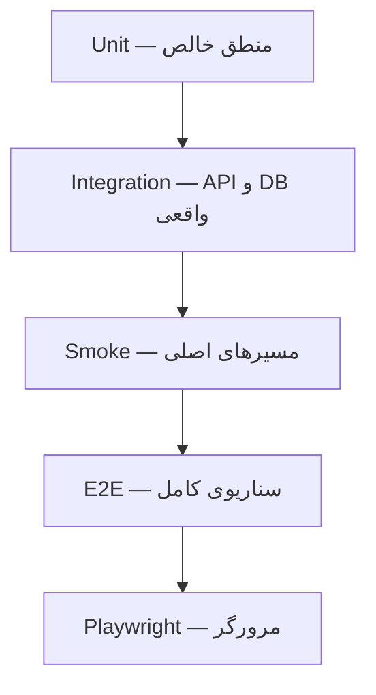

# فصل ۱۴ — استراتژی تست

> **خلاصه:** NetWatch چند لایه تست دارد: Unit، Web، Integration، E2E و
> Playwright. این فصل نشان می‌دهد هر تست چه چیزی را می‌سنجد، چگونه دادهٔ
> واقعی را لمس نکنیم و برای یک تغییر جدید چه تستی بنویسیم.
>
> **نرم‌افزارها:** `node:test`، `node --experimental-strip-types`،
> Playwright، `helpers.mjs`، Smoke Script.

---

## ۱. هرم تست پروژه



| لایه | فرمان | دامنه |
| --- | --- | --- |
| Unit | `test:unit` | توابع، Engine، DB، امنیت |
| Web | `test:web` | منطق Frontend بدون مرورگر |
| Integration | `test:integration` | سرور واقعی + SQLite موقت |
| E2E | `test:e2e` | Smoke + سناریو |
| UI | `test:ui` | Chromium/Chrome |

---

## ۲. جداسازی داده

هر فایل آزمون پیش از import کردن `db.js` مسیر دادهٔ موقت خودش را می‌سازد:

```js
export function useTempDataDir(tag = 'test') {
  const dir = fs.mkdtempSync(path.join(os.tmpdir(), `netwatch-${tag}-`));
  process.env.NETWATCH_DATA_DIR = dir;
  return dir;
}
```

سپس:

```js
const dir = useTempDataDir('credentials-api');
const server = await startServer({ dataDir: dir });
// ...
after(async () => {
  await server.stop();
  cleanupDir(dir);
});
```

قواعد:

- هرگز `data/netwatch.db` واقعی را لمس نکنید.
- هر فایل، DATA_DIR خودش را داشته باشد.
- سرور واقعی روی پورت آزاد اجرا شود.
- پس از تست، سرور و پوشه پاک شوند.
- `PORT=0` را با `env -u PORT` دور بزنید.

---

## ۳. Unit

برای منطق خالص:

- توابع `parse/serialize/normalize`.
- گذار وضعیت موتور با Probe جعلی.
- محاسبات تاریخ/آمار.
- Query Plan.
- اعتبارسنجی CIDR و امنیت.

```js
const eng = new MonitoringEngine({ emitToBus: false });
eng.probe = async () => probeResult(false);

for (let i = 0; i < 3; i++) {
  await eng.checkDevice(deviceRow(db, id), { manual: true });
}
assert.equal(deviceRow(db, id).status, STATUS.OFFLINE);
```

نکته: وابستگی شبکه/ساعت را Mock کنید؛ تست Unit نباید به اینترنت یا ICMP
واقعی وابسته باشد.

---

## ۴. Web

`web/tests/*.test.ts` منطق قابل تست بدون DOM را می‌سنجد:

- محاسبات Uptime.
- پارس فیلتر.
- geometry دیاگرام.
- style نقشه.
- Jalali.
- Live buffer.

```bash
node --experimental-strip-types --test web/tests/*.test.ts
```

---

## ۵. Integration

سرور واقعی روی DATA_DIR موقت:

```js
const server = await startServer({ dataDir: dir });
const res = await api(server.base, 'GET', '/api/credentials');
assert.equal(res.status, 200);
```

پوشش:

- Auth/CSRF/Origin.
- RBAC Matrix.
- CRUD و قرارداد.
- Backup/Restore.
- MBTiles.
- Diagram.
- SSE.
- Lifecycle.

---

## ۶. E2E و Smoke

```bash
npm run test:e2e
```

- `server/tests/smoke.mjs`: مسیرهای اصلی و خروجی.
- `server/tests/e2e/*.test.mjs`: سناریوهای واقعی.

Smoke باید سریع باشد؛ E2E می‌تواند کامل‌تر و کندتر باشد.

---

## ۷. Playwright

```bash
npx playwright install chromium
npm run test:ui
```

اگر مرورگر bundled نصب نیست:

```bash
# استفاده از Chrome سیستم با کانفیگ موقت
npx playwright test --config=playwright.chrome.local.config.ts
```

سناریوهای موجود:

- Login و RTL.
- Dashboard.
- CRUD تجهیز.
- فیلتر و Empty State.
- Import CSV.
- Map.
- SSE disconnect/reconnect.
- API failure.
- Viewer read-only.
- Mobile overflow.

---

## ۸. تست امنیت

حداقل برای هر Endpoint حساس:

| مورد | انتظار |
| --- | --- |
| بدون نشست | 401 |
| Viewer | 403 |
| Operator بدون مجوز | 403 |
| CSRF نامعتبر | 403 |
| Origin نامعتبر | 403 |
| ورودی تزریقی | 400/بی‌اثر |
| پاسخ حساس | بدون رمز/توکن |

آزمون‌های مرتبط:

- `credentials-api.test.mjs`
- `rbac-matrix.test.mjs`
- `phase3-security.test.mjs`
- `security.test.mjs`

---

## ۹. تست هم‌زمانی و Rollback

- دو درخواست هم‌زمان برای یک منبع.
- ظرفیت دیاگرام پر.
- Backup ناقص.
- حذف فایل در حال استفاده.
- تراکنش شکست‌خورده و بازگشت فایل.

```js
const [a, b] = await Promise.all([
  api(base, 'POST', '/api/devices/bulk', { ids: [id], action: 'ping' }),
  api(base, 'POST', '/api/devices/bulk', { ids: [id], action: 'ping' }),
]);
assert.equal(a.status, 202);
assert.equal(b.status, 202);
```

---

## ۱۰. اجرای کامل

```bash
env -u PORT npm run lint
env -u PORT npm run typecheck
env -u PORT npm run build
env -u PORT npm run test:unit
env -u PORT npm run test:web
env -u PORT npm run test:integration
env -u PORT npm run test:e2e
env -u PORT npm run test:ui
```

`npm run verify` همان زنجیره را (بدون UI) یک‌جا اجرا می‌کند.

---

## ۱۱. تمرین

1. برای یک تابع خالص، Unit بنویسید.
2. برای یک Endpoint جدید، 401/403/200 بنویسید.
3. یک Backup ناقص بسازید و انتظار خطا را تست کنید.
4. یک سناریوی Playwright برای صفحهٔ تازه اضافه کنید.

---

## ۱۲. چک‌لیست پایان فصل

- [ ] هرم تست را می‌شناسم.
- [ ] DATA_DIR موقت و cleanup را رعایت می‌کنم.
- [ ] Unit را از شبکه جدا می‌کنم.
- [ ] Integration را روی سرور واقعی می‌نویسم.
- [ ] تست امنیتی و هم‌زمانی را فراموش نمی‌کنم.
- [ ] خروجی تست را با exit code بررسی می‌کنم.

**فصل بعد:** [سخت‌سازی امنیتی](15-security-hardening.md)
