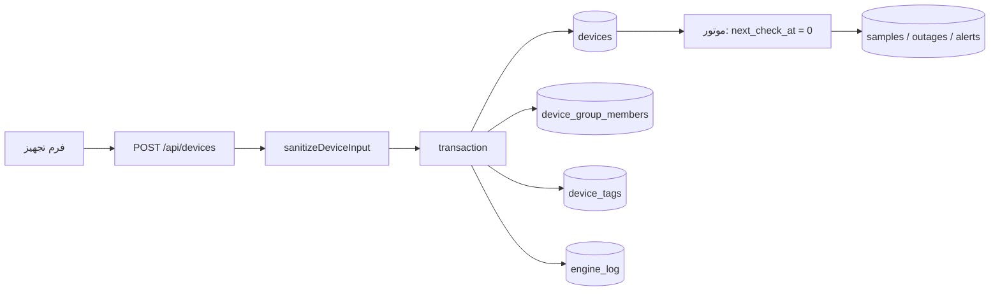

# فصل ۱۹ — چرخهٔ تجهیز، دارایی و ورود گروهی

> **خلاصه:** این فصل کل عمر یک تجهیز را از لحظهٔ ساخت تا حذف دنبال می‌کند:
> اعتبارسنجی ورودی، گروه و تگ، نوع تجهیز، فیلترهای فهرست، عملیات گروهی،
> ورود/خروجی Excel و CSV، مختصات جغرافیایی و پیوست‌ها. اینجا مرز بین «دادهٔ
> دارایی» و «وضعیت پایش» را یاد می‌گیرید تا بدانید هر تغییر کدام بخش را تحت
> تأثیر می‌گذارد.
>
> **نرم‌افزارها:** Express، `node:sqlite`، Multer، `xlsx` و React.
>
> **پیش‌نیاز:** فصل‌های ۵ (Schema)، ۶ (Store) و ۷ (API).

---

## ۱. تجهیز فقط یک ردیف نیست

یک تجهیز در NetWatch چهار لایهٔ مستقل دارد که با هم یک موجودیت می‌سازند:

| لایه | نمونهٔ فیلد | مالک / محل |
| --- | --- | --- |
| هویت دارایی | نام، IP، hostname، نوع، سازنده، مدل، سریال، MAC، پلاک اموال | `devices` |
| جایگاه سازمانی | گروه، تگ‌ها، ساختمان، رک، مسئول، مختصات | `devices`، `groups`، `tags` |
| سیاست پایش | بازه، timeout، تعداد بسته، تلاش مجدد، آستانه‌ها، فعال بودن | `devices` |
| وضعیت اجرایی | status، آخرین RTT، uptime، قطعی باز، شمارنده‌ها | موتور روی `devices` می‌نویسد |
| دسترسی حساس | نام کاربری/رمز دسترسی، پیوست‌ها | رمزنگاری‌شده در `devices` و `device_attachments` |

نکتهٔ کلیدی: **ذخیرهٔ یک فیلد دارایی، وضعیت پایش را بازنویسی نمی‌کند.** اگر
فقط `owner` یا `rack` را عوض کنید، موتور منتظر نمی‌ماند و status تغییر نمی‌کند.
در مقابل، تغییر `enabled` یا `monitoring_enabled` به صفر، وضعیت اجرایی را
می‌بندد و قطعی باز را پایان می‌دهد.



---

## ۲. فیلدهای قابل قبول و مرزهای واقعی

`sanitizeDeviceInput` در `server/store.js` فقط کلیدهای مجاز را می‌پذیرد. هر
کلید ناشناخته بی‌صدا حذف می‌شود؛ بنابراین اگر فیلد تازه‌ای به UI اضافه کردید و
در `ALLOWED_INPUT` نیست، هیچ خطایی نمی‌بینید اما داده ذخیره نمی‌شود.

### ۲.۱. رشته‌ها

| فیلد | سقف نویسه | نکته |
| --- | ---: | --- |
| `name` | ۱۲۰ | در حالت ساخت الزامی |
| `ip` | ۴۵ | باید IPv4/IPv6 معتبر باشد |
| `hostname` | ۲۵۵ | اختیاری |
| `device_type` | ۶۰ | در فهرست انواع ثبت می‌شود |
| `mac_address` | ۳۲ | به قالب `AA:BB:CC:DD:EE:FF` نرمال می‌شود |
| `asset_tag` | ۶۰ | پلاک اموال |
| `group` | ۱۲۰ | نام گروه؛ در صورت نبود، گروه ساخته/پیدا می‌شود |
| `location` / `building` | ۱۲۰ | فیلتر مستقیم فهرست |
| `rack` | ۶۰ | جای فیزیکی |
| `vendor` / `model` / `serial` | ۸۰ | گزارش دارایی |
| `firmware` | ۶۰ | نسخهٔ ثابت |
| `owner` | ۸۰ | مسئول تجهیز |
| `notes` | ۲۰۰۰ | متن آزاد |

### ۲.۲. عددها

| فیلد | بازه | پیش‌فرض معنایی |
| --- | --- | --- |
| `ping_interval` | ۵ تا ۸۶۴۰۰ ثانیه | خالی یعنی بازهٔ عمومی |
| `timeout_ms` | ۱۰۰ تا ۳۰۰۰۰ | خالی یعنی timeout عمومی |
| `packet_count` | ۱ تا ۱۰ | خالی یعنی مقدار عمومی |
| `retries` | ۰ تا ۵ | خالی یعنی مقدار عمومی |
| `latency_threshold` | ۰ تا ۶۰۰۰۰ | خالی یعنی آستانهٔ عمومی |
| `loss_threshold` | ۰ تا ۱۰۰ | درصد |
| `latitude` | ‎-۹۰ تا ۹۰ | فقط با longitude معنا دارد |
| `longitude` | ‎-۱۸۰ تا ۱۸۰ | فقط با latitude معنا دارد |

مقدار `null` یا رشتهٔ خالی برای عددها **مجاز** است و معنایش «ارث‌بری از
تنظیمات عمومی» است. عدد خارج از بازه خطای ۴۰۰ با نام فارسی فیلد می‌دهد؛
همین پیام در فرم UI نمایش داده می‌شود:

```json
{ "error": "مقدار «بازه بررسی (ثانیه)» نامعتبر است (بازهٔ مجاز: 5 تا 86400)." }
```

### ۲.۳. فیلدهای ویژه

| ورودی | رفتار |
| --- | --- |
| `tags` / `tagNames` | آرایه؛ تگ‌ها ساخته یا متصل می‌شوند |
| `group_ids` / `groupIds` | آرایه؛ نرمال‌ساز فعلی فقط یک گروه را نگه می‌دارد |
| `group_id` | شناسهٔ گروه؛ صفر/نامعتبر به `null` تبدیل می‌شود |
| `map_layer_id` | لایهٔ نقشه؛ مثبت یا `null` |
| `priority` | `low`، `normal`، `high`، `critical`؛ مقدار دیگر `normal` |
| `enabled` / `monitoring_enabled` | `true/1/'1'/'true'` یعنی روشن؛ بقیه صفر |
| `installedAt` / `installed_at` | epoch ms یا ISO؛ در DB همیشه epoch |
| `access_username` | رمزنگاری و ذخیره می‌شود |
| `access_password` | فقط در لحظهٔ نوشتن؛ هرگز در پاسخ برنمی‌گردد |
| `clear_access_password` | با `true` رمز قبلی پاک می‌شود |

`status` فقط از سمت موتور معنا دارد، اما در ورودی مجاز است. برای ساخت دستی
همیشه `unknown` بگذارید تا اولین Probe وضعیت را تعیین کند.

---

## ۳. مسیر ساخت: از درخواست تا اولین Probe

### ۳.۱. بدنهٔ درخواست

```bash
CSRF=$(awk '/nw_csrf/ {print $7}' cookies.txt)

curl -s -b cookies.txt -X POST http://127.0.0.1:8787/api/devices \
  -H 'Content-Type: application/json' \
  -H "X-CSRF-Token: $CSRF" \
  -d '{
    "name": "Core-SW-01",
    "ip": "10.0.0.2",
    "hostname": "core-sw-01.corp",
    "device_type": "سوئیچ",
    "group_id": 1,
    "priority": "critical",
    "vendor": "Cisco",
    "model": "C9300",
    "serial": "FOC1234",
    "mac_address": "00-1A-2B-3C-4D-5E",
    "asset_tag": "IT-00421",
    "location": "دیتاسنتر اصلی",
    "building": "ساختمان A",
    "rack": "R12",
    "latency_threshold": 80,
    "loss_threshold": 5,
    "tags": ["هسته", "فیبر"]
  }'
```

پاسخ `201` شکل تجهیز سریال‌شده را می‌دهد. فیلدهای `accessUsername` و
`hasAccessPassword` ممکن است حاضر باشند، اما خود رمز هرگز در پاسخ نیست.

### ۳.۲. چه اتفاقی در تراکنش می‌افتد؟

```js
return transaction(() => {
  const dup = db.prepare('SELECT id, name FROM devices WHERE ip = ?').get(payload.ip);
  if (dup) throw new Error(`آدرس IP تکراری است — در اختیار تجهیز «${dup.name}»`);

  const res = db.prepare(
    `INSERT INTO devices(${cols.join(',')}) VALUES (${cols.map(() => '?').join(',')})`
  ).run(...vals);

  setDeviceGroups(id, payload.group_ids ?? [payload.group_id]);
  attachTags(id, payload.tags, { replace: true });
  ensureDeviceType(payload.device_type);
  db.prepare('INSERT INTO engine_log(ts, level, message) VALUES (?,?,?)')
    .run(now, 'info', `تجهیز «${payload.name}» (${payload.ip}) افزوده شد`);
  return getDevice(id);
});
```

چهار نتیجهٔ مهم:

1. **IP یکتا است.** دو تجهیز با یک IP ساخته نمی‌شوند. پیام خطا نام تجهیز
   موجود را می‌گوید تا اپراتور بداند کدام رکورد را باید ویرایش کند.
2. **`next_check_at = 0`** یعنی تجهیز در اولین چرخهٔ موتور واجد بررسی است؛
   لازم نیست تا بازهٔ بعدی صبر کنید.
3. **گروه/تگ/نوع/لاگ هم‌تراکنشی‌اند.** اگر ساخت تگ شکست بخورد، تجهیز
   نیمه‌کاره باقی نمی‌ماند.
4. **نام کاربری دسترسی رمزنگاری می‌شود، نه هش.** چون باید دوباره نمایش داده
   شود؛ جزئیات در فصل ۲۳.

### ۳.۳. خطاهای رایج ساخت

| وضعیت | پیام/علت | رفع |
| --- | --- | --- |
| `400` | «نام تجهیز الزامی است» | `name` خالی است |
| `400` | «آدرس IP نامعتبر است» | IPv4/IPv6 یا hostname اشتباه |
| `400` | «آدرس IP تکراری است» | رکورد موجود را ویرایش یا IP را عوض کنید |
| `400` | «آدرس MAC نامعتبر است» | ۱۲ رقم hex با جداکنندهٔ رایج |
| `400` | بازهٔ عددی | مقدار را داخل بازه ببرید یا خالی بگذارید |
| `403` | مجوز نوشتن نیست | نقش Operator/Admin لازم است |
| `415` | Content-Type اشتباه | `application/json` بفرستید |

---

## ۴. به‌روزرسانی، خاموش‌کردن پایش و حذف

### ۴.۱. PATCH در برابر PUT

- `PATCH` فقط فیلدهای ارسالی را تغییر می‌دهد (`partial: true`).
- `PUT` انتظار بدنهٔ کامل‌تر دارد؛ فیلدهای غایب ممکن است خالی شوند.
- برای فرم‌های ویرایش، `PATCH` امن‌تر است.
- برای تغییر رمز دسترسی، `clear_access_password` را صریح بفرستید.

```bash
curl -s -b cookies.txt -X PATCH http://127.0.0.1:8787/api/devices/17 \
  -H 'Content-Type: application/json' -H "X-CSRF-Token: $CSRF" \
  -d '{"owner":"تیم شبکه","rack":"R14","monitoring_enabled":false}'
```

### ۴.۲. وقتی پایش خاموش می‌شود

`closeDeviceMonitoringState` در `server/store.js` این کارها را انجام می‌دهد:

- قطعی باز تجهیز بسته می‌شود؛
- هشدارهای فعال مربوط به offline/latency/loss حل می‌شوند؛
- `current_outage_id` و `current_outage_started_at` پاک می‌شوند؛
- تجهیز دیگر در صف `next_check_at` قرار نمی‌گیرد.

اگر فقط `enabled = 0` کنید، تجهیز از فهرست فعال و آمار حذف می‌شود. اگر
`monitoring_enabled = 0` باشد، رکورد دارایی می‌ماند اما Probe انجام نمی‌شود.

### ۴.۳. حذف

حذف تجهیز با `DELETE /api/devices/:id` انجام می‌شود. جدول‌های وابسته با
`ON DELETE CASCADE` پاک می‌شوند؛ پیوست‌ها ابتدا در DB حذف و فایل‌شان در Sweep
بعدی جمع‌آوری می‌شود. حذف گروهی از مسیر bulk استفاده می‌کند و برای تعداد زیاد
بهتر است ابتدا خروجی بگیرید.

---

## ۵. فهرست، فیلتر و صفحه‌بندی

`GET /api/devices` از `parseListQuery` و `buildDeviceWhere` استفاده می‌کند.

| پارامتر | پیش‌فرض | نکته |
| --- | --- | --- |
| `page` | ۱ | صفحهٔ عددی |
| `pageSize` | ۲۴ | حداکثر ۵۰۰ |
| `search` | — | نام، IP، hostname، محل، سازنده، مدل، سریال، MAC، پلاک و شناسه |
| `group` | — | شناسه یا نام گروه |
| `tag` | — | شناسه یا نام تگ |
| `status` | — | `online`، `warning`، `offline`، `maintenance`، `unknown`، `high_latency` |
| `type` | — | نوع تجهیز |
| `priority` | — | اولویت |
| `location` | — | محل |
| `enabled` | — | `0` یا `1` |
| `geo` | — | `with` یا `without` |
| `installedFrom` / `installedTo` | — | تاریخ نصب؛ پایان بازه شامل همان روز |
| `sort` | `name` | `ip`، `status`، `group`، `latency`، `avg_latency`، `loss`، `uptime`، `last_check`، `outages`، `created`، `installed` |
| `order` | `asc` | `asc` یا `desc` |

نکتهٔ ظریف: فیلتر `status=online` تجهیزات `warning` را هم برمی‌گرداند، چون
داشبورد «وصل» را `online + warning` می‌شمارد. برای فقط وضعیت دقیق، از
`status=warning` یا فیلتر سمت کلاینت استفاده کنید.

`status=high_latency` وضعیت ذخیره‌شده نیست؛ یک شرط محاسباتی است:
`last_rtt_ms > COALESCE(latency_threshold, general_threshold)`.

---

## ۶. عملیات گروهی و Job Probe

`POST /api/devices/bulk` یک بدنهٔ `{ ids, action, ... }` می‌گیرد. اکشن‌های
پشتیبانی‌شده:

| اکشن | اثر |
| --- | --- |
| `enable` / `disable` | فعال/غیرفعال کردن رکورد |
| `monitoring_on` / `monitoring_off` | روشن/خاموش کردن Probe |
| `group` | انتقال به گروه (`groupId`) |
| `priority` | تغییر اولویت |
| `interval` | تغییر بازهٔ بررسی |
| `tag` / `untag` | افزودن/حذف تگ |
| `delete` | حذف گروهی |
| `ping` | اجرای Probe گروهی به‌صورت Job |

Probe گروهی همگام نیست؛ پاسخ `202` با `jobId` و `statusUrl` برمی‌گردد:

```bash
curl -s -b cookies.txt -X POST http://127.0.0.1:8787/api/devices/bulk \
  -H 'Content-Type: application/json' -H "X-CSRF-Token: $CSRF" \
  -d '{"ids":[17,18,19],"action":"ping"}'
```

```json
{
  "accepted": 3,
  "jobId": "probe-8f2c…",
  "statusUrl": "/api/devices/bulk/probe/probe-8f2c…"
}
```

Job فقط برای مالک یا Administrator قابل مشاهده است. برای تعداد زیاد، Job را
poll کنید و هم‌زمان درخواست تکراری نسازید.

---

## ۷. ورود و خروجی گروهی

### ۷.۱. مسیرها

| متد | مسیر | کار |
| --- | --- | --- |
| GET | `/api/devices/template` | قالب Excel ورودی |
| GET | `/api/devices/export?format=xlsx` | خروجی کامل |
| POST | `/api/devices/import/preview` | اعتبارسنجی بدون نوشتن |
| POST | `/api/devices/import/commit` | نوشتن ردیف‌های معتبر |
| GET | `/api/devices/export/geo` | خروجی مختصات |
| POST | `/api/devices/import/geo` | ورود مختصات |

فرمت فایل با پسوند تشخیص داده می‌شود: `.xlsx`، `.xls` یا `.csv`. سقف پیش‌فرض
حجم **۱۰ مگابایت** است و با `NETWATCH_MAX_IMPORT_BYTES` (بین ۶۴KiB و ۱۰۰MiB)
تغییر می‌کند.

### ۷.۲. ستون‌های شناخته‌شده

خروجی و قالب از `EXPORT_HEADERS` ساخته می‌شوند. مهم‌ترین ستون‌ها:

```text
نام تجهیز | آدرس IP | نام هاست | نوع تجهیز | گروه | محل استقرار
ساختمان | رک | عرض جغرافیایی | طول جغرافیایی | سازنده | مدل
سریال | آدرس MAC | پلاک اموال | مسئول | اولویت
بازه بررسی (ثانیه) | زمان انتظار (میلی‌ثانیه) | تگ‌ها
فعال | مانیتورینگ فعال | توضیحات
```

سرستون‌ها با نرمال‌سازی مقایسه می‌شوند: نیم‌فاصله، یکای داخل پرانتز، فاصله،
زیرخط، نقطه و خط تیره اهمیتی ندارند. بنابراین «بازه بررسی (ثانیه)» و
«بازه بررسی» یکسان‌اند. با این حال، برای فایل‌های تولیدی از قالب رسمی استفاده
کنید تا غافلگیر نشوید.

### ۷.۳. الگوی Preview → Commit

1. فایل را با `multipart/form-data` و فیلد `file` بفرستید.
2. Preview تعداد ردیف‌های معتبر/نامعتبر و خطاها را برمی‌گرداند.
3. اگر خطاها قابل قبول بود، Commit را با همان فایل/داده اجرا کنید.
4. نتیجهٔ Commit شامل تعداد ایجاد/به‌روزرسانی است.

این دو مرحله برای جلوگیری از ورود نیمه‌کاره طراحی شده‌اند؛ هرگز مستقیم روی
پایگاه‌دادهٔ تولیدی تست نکنید. ابتدا روی `NETWATCH_DATA_DIR` موقت اجرا کنید:

```bash
NETWATCH_DATA_DIR=/tmp/nw-import-test NETWATCH_SEED_DEMO=0 npm start
```

### ۷.۴. ورود مختصات

`POST /api/devices/import/geo` فقط latitude/longitude را به تجهیزات موجود
متصل می‌کند و رکورد جدید نمی‌سازد. برای نقشه، ابتدا تجهیز را بسازید و سپس
مختصات را وارد کنید.

---

## ۸. قالب‌های تجهیز

> **گروه، تگ و نوع:** این سه فهرست مرجع در `/settings` مدیریت می‌شوند و API
> آن‌ها در بخش `inventory` است. حذف گروه با `?moveTo=<id>` تجهیزات را منتقل
> می‌کند؛ بدون آن، تجهیزات بی‌گروه می‌شوند. حذف نوعی که تجهیزی با آن وجود
> دارد با `400` رد می‌شود؛ برای تغییر نام از `PUT /api/device-types/:id`
> استفاده کنید تا همهٔ تجهیزات همان نوع هم به‌روز شوند. تگ‌ها از طریق
> `POST /api/tags/:tagId/devices` (با `mode=add|remove`) به تجهیز متصل/جدا
> می‌شوند و `show_on_map` آن‌ها نمایش روی نقشه را کنترل می‌کند.

قالب (`device_templates`) مجموعه‌ای از تنظیمات مشترک است که روی چند تجهیز
اعمال می‌شود. قالب **هویت تجهیز را عوض نمی‌کند**؛ فقط فیلدهای عملیاتی مجاز را
می‌گیرد:

```text
device_type | vendor | model | firmware | priority | monitoring_enabled
ping_interval | timeout_ms | packet_count | retries
latency_threshold | loss_threshold
```

`name`، `ip`، `group`، `location` و اعتبارنامه عمداً جزو قالب نیستند.

### ۸.۱. API

| متد | مسیر | کار |
| --- | --- | --- |
| GET | `/api/templates` | فهرست + فیلدهای قابل اعمال |
| POST | `/api/templates` | ساخت |
| PUT | `/api/templates/:id` | ویرایش |
| DELETE | `/api/templates/:id` | حذف |
| POST | `/api/templates/:id/apply` | اعمال روی تجهیزات |

### ۸.۲. معنای `overwrite`

```js
const isEmpty = current === null || current === undefined || current === '';
if (!overwrite && !isEmpty) {
  preserved.push(key);
  continue;
}
```

- `overwrite=false` (پیش‌فرض): فقط فیلدهای **خالی** پر می‌شوند. تنظیم اختصاصی
  تجهیز دست‌نخورده می‌ماند.
- `overwrite=true`: مقدار قالب جایگزین می‌شود؛ برای این کار تأیید صریح UI لازم
  است.
- `fields` می‌تواند زیرمجموعه‌ای از فیلدها را انتخاب کند.
- حداکثر ۵۰۰ تجهیز در هر اعمال.

```bash
curl -s -b cookies.txt -X POST http://127.0.0.1:8787/api/templates/3/apply \
  -H 'Content-Type: application/json' -H "X-CSRF-Token: $CSRF" \
  -d '{"deviceIds":[17,18],"fields":["ping_interval","retries"],"overwrite":false}'
```

پاسخ `updated`، `skipped` و `details` را می‌دهد. `preserved` نشان می‌دهد کدام
فیلدها دست‌نخورده مانده‌اند؛ اگر انتظار داشتید قالبی اعمال شود و نشد، اول این
فهرست را ببینید.

> «قالب تجهیز» با «چیدمان ویجت‌ها» فرق دارد. دومی فقط ظاهر داشبورد/جزئیات را
> ذخیره می‌کند و روی فیلدهای تجهیز اثری ندارد.

---

## ۹. پیوست‌ها

پیوست‌ها زیرمجموعهٔ تجهیز هستند و با `GET/POST /api/devices/:id/attachments`
مدیریت می‌شوند.

| ویژگی | مقدار |
| --- | --- |
| سقف سخت | ۵۰ مگابایت |
| سقف مؤثر | تنظیم `attachment_max_mb` (۱ تا ۵۰) |
| انواع مجاز | PNG، JPEG، GIF، WebP، PDF، متن ساده |
| ذخیره | `<DATA_DIR>/attachments` با نام تولیدی |
| دانلود | تصویر inline، بقیه attachment |
| کش | `private, max-age=60` |

نوع فایل از **امضای بایت‌ها** تشخیص داده می‌شود، نه پسوند. اگر DB شکست بخورد،
فایل نوشته‌شده حذف می‌شود تا فایل یتیم نماند. هنگام حذف، ابتدا رکورد DB حذف
می‌شود و فایل در Sweep بعدی پاک می‌شود؛ این ترتیب از حذف فایلِ در حال استفاده
جلوگیری می‌کند.

---

## ۱۰. سمت رابط کاربری

| صفحه/کامپوننت | مسئولیت |
| --- | --- |
| `pages/Devices.tsx` | فهرست، فیلتر، انتخاب گروهی، Import/Export |
| `features/DeviceForm.tsx` | فرم ساخت/ویرایش و اعتبارسنجی UX |
| `pages/DeviceDetail.tsx` | نمودار، قطعی‌ها، تعمیرات، اعتبارنامه، پیوست |
| `features/ImportDialog.tsx` | Preview/Commit ورود گروهی |

الگوی فرم:

1. State محلی برای فیلدها.
2. اعتبارسنجی کلاینت فقط برای بازخورد سریع.
3. ارسال به API و نمایش پیام خطای سرور.
4. غیرفعال‌کردن دکمه در حین ارسال.
5. بستن فرم و Refresh فهرست پس از موفقیت.

هیچ‌گاه مجوز را فقط با پنهان‌کردن دکمه اعمال نکنید؛ `devices:write` در سرور
مرجع است.

---

## ۱۱. آزمون‌های مرتبط

```bash
env -u PORT node --experimental-strip-types --test server/tests/unit/device-input.test.mjs
env -u PORT node --experimental-strip-types --test server/tests/unit/diagram-prune.test.mjs
env -u PORT node --experimental-strip-types --test server/tests/integration/api.test.mjs
env -u PORT node --experimental-strip-types --test server/tests/integration/probe-bulk.test.mjs
env -u PORT node --experimental-strip-types --test server/tests/integration/security.test.mjs
```

برای تغییر در ورودی تجهیز، حداقل یک تست برای:

- IP نامعتبر و تکراری؛
- MAC نامعتبر؛
- بازهٔ عددی؛
- خاموش‌کردن پایش و بسته‌شدن قطعی؛
- ورود گروهی با ستون فارسی.

---

## ۱۲. تمرین

1. یک تجهیز با IP تکراری بسازید و پیام خطا را ببینید.
2. همان تجهیز را با `PATCH` فقط در فیلد `owner` تغییر دهید و بررسی کنید
   `status` و `lastCheckAt` تغییر نکرده‌اند.
3. `monitoring_enabled` را خاموش کنید و در DB بررسی کنید قطعی باز بسته شده
   است.
4. یک فایل CSV با ۳ ردیف معتبر و ۱ ردیف با IP خراب بسازید؛ Preview و Commit
   را اجرا کنید و تفاوت را ببینید.
5. یک پیوست PDF و یک فایل `.exe` آپلود کنید؛ دومی باید `415` بگیرد.
6. یک Probe گروهی روی ۳ تجهیز اجرا کنید و `statusUrl` را تا پایان poll کنید.

---

## ۱۳. چک‌لیست پایان فصل

- [ ] چهار لایهٔ دادهٔ تجهیز را می‌شناسم.
- [ ] می‌دانم کدام فیلدها خالی به معنی «ارث‌بری» هستند.
- [ ] تراکنش ساخت و نقش `next_check_at = 0` را می‌فهمم.
- [ ] تفاوت `enabled` و `monitoring_enabled` را می‌دانم.
- [ ] فیلترها و مرتب‌سازی فهرست را می‌شناسم.
- [ ] عملیات گروهی و Job Probe را بلدم.
- [ ] مسیر Preview/Commit ورود گروهی را می‌دانم.
- [ ] قالب تجهیز و معنای `overwrite` را می‌دانم.
- [ ] محدودیت‌ها و امنیت پیوست را می‌فهمم.
- [ ] تست‌های مرتبط را اجرا کرده‌ام.

**فصل بعد:** [هشدارها، تعمیرات و مدیریت حادثه](20-alerts-maintenance-incidents.md)
