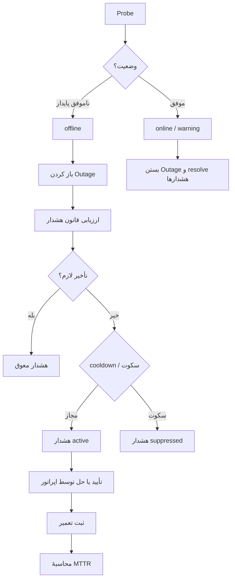

# فصل ۲۰ — هشدارها، تعمیرات و مدیریت حادثه

> **خلاصه:** یک Probe ناموفق به‌تنهایی «هشدار» نیست. این فصل زنجیرهٔ کامل را
> توضیح می‌دهد: نمونه → تشخیص وضعیت → قطعی → قانون هشدار → تأخیر → cooldown →
> ساعات سکوت → هشدار قابل تأیید → ثبت تعمیر → MTTR. همچنین پنجره‌های تعمیرات،
> عملیات گروهی و تحلیل نوسان را پوشش می‌دهد.
>
> **نرم‌افزارها:** موتور NetWatch، Express و React.
>
> **پیش‌نیاز:** فصل ۹ (موتور پایش) و فصل ۱۰ (SSE).

---

## ۱. زنجیرهٔ حادثه در یک نگاه



هر مرحله یک رکورد یا یک تصمیم مستقل دارد. اگر هشداری ساخته نشد، ابتدا مشخص
کنید کدام مرحله آن را متوقف کرده است؛ «موتور خراب است» معمولاً پاسخ درستی نیست.

---

## ۲. وضعیت‌ها و تفکیک دسترسی از سرویس

| وضعیت | معنا | اثر |
| --- | --- | --- |
| `online` | Probe موفق و زیر آستانه‌ها | resolve هشدارهای دستگاه |
| `warning` | تأخیر یا افت بسته بالای آستانه | هشدار latency/loss |
| `offline` | شکست پایدار پس از تلاش‌ها | باز کردن Outage |
| `maintenance` | داخل پنجرهٔ تعمیرات | Probe و هشدار سرکوب |
| `unknown` | هنوز بررسی نشده | بدون هشدار |

`serviceStatus` جدا از status شبکه است: ممکن است ICMP موفق باشد اما سرویس روی
پورت پاسخ ندهد. این تفکیک باعث می‌شود «شبکه قطع است» با «سرویس بالا نیست»
اشتباه گرفته نشود.

---

## ۳. قانون هشدار: چه چیزی واقعاً اثر دارد؟

هر ردیف `alert_rules` این فیلدها را دارد:

| فیلد | اثر اجرایی |
| --- | --- |
| `metric` | `offline`، `latency`، `loss`، `recovery` |
| `scope_group_id` | قانون فقط برای همان گروه |
| `duration_sec` | مدت پایداری شرط پیش از هشدار |
| `cooldown_sec` | فاصلهٔ حداقل بین دو هشدار هم‌نوع همان تجهیز |
| `silent` | در ساعات سکوت سرکوب شود |
| `enabled` | قانون فعال |
| `threshold` / `comparator` / `severity` | ذخیره می‌شوند؛ آستانهٔ واقعی از تنظیمات/تجهیز می‌آید |

انتخاب قانون در `raiseAlert`:

```js
const rule =
  rules.find((r) => r.metric === mapped &&
    (!r.scope_group_id || r.scope_group_id === device.group_id)) ||
  rules.find((r) => r.metric === mapped) ||
  null;
```

یعنی قانون گروه‌محور بر قانون عمومی اولویت دارد. اگر هیچ قانونی نباشد،
مقادیر عمومی `alert_delay` و `alert_cooldown` استفاده می‌شوند.

> **محدودیت مهم:** `threshold`، `comparator` و `severity` در این نسخه رفتار
> اجرایی کامل ندارند. آستانهٔ latency/loss از فیلد تجهیز یا تنظیمات خوانده
> می‌شود و severity پیش‌فرض کد است. برای تغییر واقعی آستانه، فیلد تجهیز یا
> تنظیمات عمومی را عوض کنید.

---

## ۴. تأخیر، لغو و cooldown

### ۴.۱. تأخیر مؤثر

```js
const delaySec = Math.max(
  0,
  Number(rule?.duration_sec) || 0,
  Number(settings.alert_delay) || 0
);
```

اگر قانون ۱۲۰ ثانیه و تنظیم عمومی ۳۰ ثانیه باشد، **۱۲۰ ثانیه** اعمال می‌شود؛
تأخیرها جمع نمی‌شوند.

در این فاصله هشدار در حافظهٔ موتور (`pending`) نگه داشته می‌شود و تایمر دارد.
اگر تجهیز به وضعیت عادی برگردد:

- `resolveDeviceAlerts` فراخوانی می‌شود؛
- `cancelDevicePending` تایمر را پاک می‌کند؛
- هشدار هرگز در DB درج نمی‌شود.

پس از پایان تأخیر، `deliverPending` دوباره وضعیت فعلی را می‌خواند. اگر شرط
دیگر برقرار نباشد، هشدار لغو می‌شود. این «بررسی دوباره» از هشدار کهنه جلوگیری
می‌کند.

### ۴.۲. cooldown و کلید تکرار

کلید هشدار `kind:deviceId` است؛ مثلاً `offline:17`. پیش از هر درج، حتی در
ساعات سکوت، آخرین هشدار همین کلید بررسی می‌شود. اگر فاصله کمتر از cooldown
باشد، هیچ ردیف تازه‌ای ساخته نمی‌شود.

این نکته برای حجم داده حیاتی است: بدون آن، در ساعات سکوت هر چرخه یک ردیف
`suppressed` می‌ساخت و جدول `alerts` با ۱۰۰۰ تجهیز در چند ساعت صدها هزار ردیف
می‌گرفت.

### ۴.۳. ساعات سکوت

اگر `suppression_enabled` روشن باشد و زمان فعلی داخل
`suppression_start`/`suppression_end` باشد، فقط هشدارهای `silent` سرکوب
می‌شوند. ردیف با status `suppressed` ذخیره می‌شود؛ نه اعلان UI می‌فرستد و نه
در شمارش هشدارهای فعال می‌آید.

بازهٔ سکوت می‌تواند از نیمه‌شب عبور کند (`22:00` تا `07:00`). مقایسه با
دقیقهٔ محلی انجام می‌شود.

---

## ۵. چرخهٔ عمر هشدار

| وضعیت | معنا | عملیات مجاز |
| --- | --- | --- |
| `active` | هشدار باز | ack، resolve، delete |
| `acknowledged` | اپراتور دیده است | resolve، delete |
| `resolved` | شرط برطرف شده یا دستی حل شده | delete |
| `suppressed` | در ساعات سکوت سرکوب شده | مشاهده/حذف |

### ۵.۱. API

| متد | مسیر | کار |
| --- | --- | --- |
| GET | `/api/alerts` | فیلتر `status`، `severity`، بازه، صفحه‌بندی |
| POST | `/api/alerts/:id/ack` | تأیید دریافت |
| POST | `/api/alerts/:id/resolve` | حل دستی |
| POST | `/api/alerts/bulk` | عملیات گروهی |
| DELETE | `/api/alerts/:id` | حذف رکورد |

```bash
CSRF=$(awk '/nw_csrf/ {print $7}' cookies.txt)

curl -s -b cookies.txt -X POST http://127.0.0.1:8787/api/alerts/91/ack \
  -H "X-CSRF-Token: $CSRF"

curl -s -b cookies.txt -X POST http://127.0.0.1:8787/api/alerts/bulk \
  -H 'Content-Type: application/json' -H "X-CSRF-Token: $CSRF" \
  -d '{"ids":[91,92],"action":"resolve"}'
```

تأیید کردن هشدار آن را حل نمی‌کند. `ack` فقط می‌گوید «دیده شد»؛ `resolve`
وضعیت را می‌بندد. برای حادثهٔ واقعی، ابتدا ack و پس از رفع، resolve بزنید.

### ۵.۲. به‌روزرسانی زنده

موتور هنگام ساخت هشدار رویدادهای زیر را منتشر می‌کند:

- `alert` برای هشدار تازه؛
- `alert-resolved` وقتی هشدارهای یک تجهیز حل می‌شوند؛
- `alerts-changed` برای تغییرات گروهی/دستی.

کلاینت `LiveProvider` این‌ها را در Store می‌ریزد و صفحهٔ هشدارها بدون Refresh
به‌روز می‌شود. اگر UI به‌روز نمی‌شود، ابتدا اتصال SSE را بررسی کنید، نه API
هشدارها را.

---

## ۶. تعمیرات: ثبت واقعیت، نه حدس

`maintenance_records` یک سند عملیاتی است، نه یک برچسب ساده. فیلدهای مهم:

| فیلد | معنا |
| --- | --- |
| `device_id` | تجهیز الزامی |
| `outage_id` | اتصال اختیاری به قطعی |
| `title` | عنوان کوتاه |
| `cause` | علت از فهرست تنظیمات |
| `action` | اقدام از فهرست تنظیمات |
| `started_at` / `ended_at` | epoch ms |
| `downtime_sec` | از اختلاف شروع/پایان محاسبه می‌شود |
| `technician` | مسئول |
| `cost` | هزینهٔ عددی |
| `description` / `notes` | شرح |
| `status` | `open` یا `closed` |

### ۶.۱. قاعدهٔ status

اگر `ended_at` بفرستید، status خودکار `closed` می‌شود. اگر نه، `open` می‌ماند.
`downtime_sec` از `ended_at - started_at` محاسبه می‌شود و مقدار دستی پذیرفته
نمی‌شود. برای بستن یک سابقهٔ باز، `PUT` با `ended_at` بفرستید.

```bash
curl -s -b cookies.txt -X POST http://127.0.0.1:8787/api/maintenance \
  -H 'Content-Type: application/json' -H "X-CSRF-Token: $CSRF" \
  -d '{
    "device_id": 17,
    "outage_id": 42,
    "title": "تعویض ماژول فیبر",
    "cause": "اختلال در زیرساخت فیبر نوری",
    "action": "تعویض ماژول",
    "started_at": 1761000000000,
    "ended_at": 1761003600000,
    "technician": "تیم شبکه",
    "cost": 0,
    "description": "پورت ۱۲ سوئیچ تا تعویض ماژول down بود."
  }'
```

### ۶.۲. چرا `outage_id` مهم است؟

MTTR فقط برای قطعی‌هایی محاسبه می‌شود که سابقهٔ تعمیر متصل دارند. این کار
عمدی است: میانگین‌گرفتن از قطعی‌های بدون تعمیر، عدد را بی‌معنا می‌کند.
`mttrEvents` تعداد نمونه‌های مبنا و `mttrExcluded` تعداد قطعی‌های حذف‌شده را
نشان می‌دهد. اگر MTTR خیلی کم یا خیلی زیاد است، اول این دو عدد را ببینید.

---

## ۷. پنجرهٔ تعمیرات

`maintenance_windows` یک بازهٔ تکرارشوندهٔ هفتگی است:

| فیلد | معنا |
| --- | --- |
| `device_id` | خالی یعنی همهٔ تجهیزات |
| `title` | نام پنجره |
| `days` | روزهای هفته با کاما؛ `0` یکشنبه … `6` شنبه |
| `start_time` / `end_time` | `HH:MM` محلی |
| `enabled` | فعال |

اگر `start_time > end_time` باشد، بازه از نیمه‌شب عبور می‌کند. در این بازه:

- تجهیز وارد `maintenance` می‌شود؛
- Probe انجام نمی‌شود؛
- هشدارهای جدید سرکوب می‌شوند.

پس از ویرایش پنجره، سرور `engine.invalidate()` را صدا می‌زند تا کش تنظیمات
موتور تازه شود. اگر پنجره را مستقیم در DB عوض کنید، این اتفاق نمی‌افتد؛ از
API استفاده کنید.

> پنجرهٔ تعمیرات با «ساعات سکوت» فرق دارد: پنجره Probe را متوقف می‌کند،
> ساعات سکوت فقط نمایش/اعلان هشدارهای `silent` را سرکوب می‌کند.

---

## ۸. تحلیل حادثه

چهار مسیر تحلیلی وجود دارد:

| مسیر | خروجی |
| --- | --- |
| `GET /api/events/flaps` | تجهیزات با نوسان مکرر در بازه |
| `GET /api/events/simultaneous` | قطعی‌های هم‌زمان (احتمال ریشهٔ مشترک) |
| `GET /api/events/timeline` | خط زمانی حوادث |
| `GET /api/events/top-outage-devices` | بیشترین قطعی/مدت |

نمونهٔ تفسیر:

- **flaps بالا + MTTR پایین:** اتصال ناپایدار یا آستانهٔ حساس؛ نه لزوماً خرابی
  سخت‌افزار.
- **simultaneous بالا:** مشکل uplink، برق یا DNS مشترک.
- **top outage با یک گروه:** تمرکز روی همان گروه، نه کل شبکه.
- **alerts زیاد ولی availability خوب:** هشدارهای latency/loss یا cooldown
  کوتاه.

---

## ۹. سمت رابط کاربری

| صفحه | مسئولیت |
| --- | --- |
| `pages/Alerts.tsx` | فهرست، فیلتر، ack/resolve، قوانین هشدار |
| `pages/Maintenance.tsx` | سوابق تعمیر، پنجره‌ها، فیلتر و خروجی |
| `pages/DeviceDetail.tsx` | قطعی‌ها و تعمیرات همان تجهیز |

الگوی درست برخورد اپراتور:

1. هشدار را ack کنید تا تیم بداند دیده شده است.
2. در صورت وجود قطعی، سابقهٔ تعمیر با `outage_id` ثبت کنید.
3. پس از رفع، resolve بزنید.
4. علت و اقدام را از فهرست استاندارد انتخاب کنید تا گزارش MTTR قابل مقایسه
   باشد.
5. اگر هشدار تکراری است، cooldown یا آستانه را اصلاح کنید؛ هشدار را بی‌صدا
   حذف نکنید.

---

## ۱۰. خطاهای رایج

| نشانه | علت احتمالی | بررسی |
| --- | --- | --- |
| هشدار ساخته نمی‌شود | `alerting_enabled=0` | تنظیمات موتور |
| هشدار با تأخیر می‌آید | `alert_delay` یا `duration_sec` بزرگ | `/api/engine/status` و قانون |
| هشدار تکراری نیست | cooldown فعال | آخرین هشدار همان کلید |
| هشدار در ساعات سکوت نیست | `silent` یا suppression | status `suppressed` |
| هشدار حل نمی‌شود | وضعیت تجهیز هنوز warning/offline | آخرین sample |
| پنجره اثر ندارد | روز/ساعت محلی یا `enabled=0` | `days` و زمان سرور |
| MTTR خالی است | تعمیر به outage وصل نیست | `outage_id` |

---

## ۱۱. آزمون‌های مرتبط

```bash
env -u PORT node --experimental-strip-types --test server/tests/unit/alert-delay.test.mjs
env -u PORT node --experimental-strip-types --test server/tests/unit/maintenance.test.mjs
env -u PORT node --experimental-strip-types --test server/tests/unit/mttr.test.mjs
env -u PORT node --experimental-strip-types --test server/tests/integration/ops.test.mjs
env -u PORT node --experimental-strip-types --test server/tests/integration/retention-api.test.mjs
```

برای تغییر در منطق هشدار، حداقل این سناریوها را تست کنید:

- شرط در مدت تأخیر برطرف شود → هیچ هشداری درج نشود؛
- cooldown مانع تکرار شود؛
- ساعات سکوت ردیف `suppressed` بسازد؛
- پنجرهٔ تعمیرات Probe را متوقف کند؛
- resolve، هشدارهای فعال همان دستگاه را ببندد.

---

## ۱۲. تمرین

1. یک قانون `offline` با `duration_sec=60` بسازید و یک تجهیز را عمداً قطع
   کنید. زمان بین قطع شدن و هشدار را اندازه بگیرید.
2. در همان ۶۰ ثانیه تجهیز را برگردانید و تأیید کنید هشدار ساخته نشده است.
3. cooldown را ۶۰۰ ثانیه بگذارید و دو بار قطع/وصل کنید؛ باید یک هشدار ببینید.
4. یک پنجرهٔ تعمیرات برای همهٔ تجهیزات امروز بسازید و مشاهده کنید status
   `maintenance` می‌شود.
5. یک تعمیر با `outage_id` ثبت کنید و MTTR گزارش را قبل/بعد مقایسه کنید.
6. خروجی `events/flaps` را برای یک تجهیز ناپایدار بگیرید و علت را حدس بزنید.

---

## ۱۳. چک‌لیست پایان فصل

- [ ] زنجیرهٔ نمونه تا هشدار را می‌شناسم.
- [ ] تفاوت وضعیت شبکه و سرویس را می‌دانم.
- [ ] می‌دانم کدام فیلدهای قانون واقعاً اثر دارند.
- [ ] تأخیر، cooldown و ساعات سکوت را می‌فهمم.
- [ ] چرخهٔ active/acknowledged/resolved/suppressed را بلدم.
- [ ] تعمیر را با outage وصل می‌کنم.
- [ ] پنجرهٔ تعمیرات را از ساعات سکوت تفکیک می‌کنم.
- [ ] MTTR و معناهای آن را می‌فهمم.
- [ ] تست‌های هشدار/تعمیر را اجرا کرده‌ام.

**فصل بعد:** [گزارش‌ها، داشبورد و تحلیل داده](21-reports-dashboard-analytics.md)
