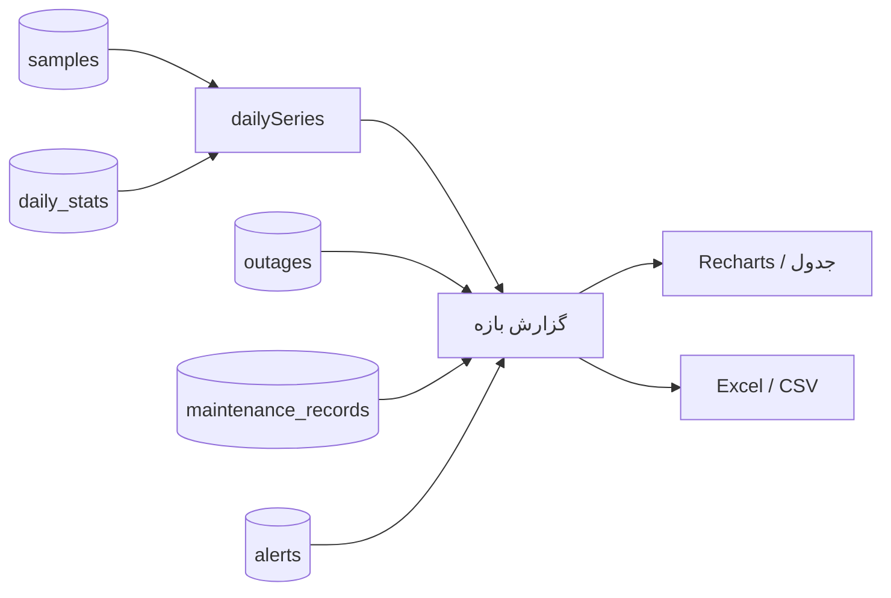

# فصل ۲۱ — گزارش‌ها، داشبورد و تحلیل داده

> **خلاصه:** این فصل می‌گوید اعداد داشبورد و گزارش از کجا می‌آیند، چگونه
> محاسبه می‌شوند و کدام عدد را کجا نباید تفسیر کرد. مسیرهای گزارش، خروجی
> Excel/CSV، شاخص سلامت، ویجت‌ها، کش و محدودیت‌های تحلیلی را پوشش می‌دهد.
>
> **نرم‌افزارها:** SQLite، Recharts، `xlsx` و Workerهای Export.
>
> **پیش‌نیاز:** فصل‌های ۵ (Schema)، ۹ (موتور) و ۱۴ (تست).

---

## ۱. دادهٔ خام، دادهٔ تجمیعی، دادهٔ مشتق

گزارش‌ها روی سه منبع سوار می‌شوند:

| منبع | دانه‌بندی | کاربرد |
| --- | --- | --- |
| `samples` | هر Probe | لبه‌های بازه، روز جاری، نمودار دقیق |
| `daily_stats` | یک روز محلی | گزارش بلندمدت پس از هرس نمونه‌ها |
| `outages` / `maintenance_records` | هر حادثه | دسترس‌پذیری، MTTR، علت |
| `alerts` | هر هشدار | شمارش هشدار و تحلیل نویز |

`dailySeries` در `server/daily.js` روزهای کامل را از `daily_stats` می‌خواند و
فقط روز جاری/لبه‌های ناقص را از `samples` پر می‌کند. این تصمیم برای عملکرد
حیاتی است: گزارش ۹۰ روزه نباید میلیون‌ها نمونهٔ خام را اسکن کند.



---

## ۲. بازهٔ زمانی و منطقهٔ زمانی

`resolveRange` قواعد زیر را دارد:

- `range` مجاز: `24h`، `7d`، `30d`، `90d`؛ پیش‌فرض `7d`.
- `from`/`to` به‌صورت epoch ms؛ اگر `from > to` باشند جابه‌جا می‌شوند.
- اگر فقط `from` بیاید، `to` برابر «اکنون» است.
- `offsetMin` از `timezone_offset_minutes` تنظیمات می‌آید.
- روزهای گزارش با `date(started_at/1000,'unixepoch', modifier)` ساخته می‌شوند.

نکتهٔ مهم: **زمان ذخیره‌شده همیشه UTC/epoch است.** تقویم شمسی/میلادی فقط
لایهٔ نمایش است. اگر مرز روز را عوض می‌کنید، `timezone_offset_minutes` را
تغییر دهید، نه دادهٔ خام را.

---

## ۳. گزارش خلاصه

`GET /api/reports/summary` با مجوز `reports:read`.

### ۳.۱. پارامترها

| پارامتر | معنا |
| --- | --- |
| `range` | `24h`/`7d`/`30d`/`90d` |
| `from`, `to` | بازهٔ دلخواه epoch ms |
| `group` | شناسه یا نام گروه |
| `tag` | شناسه یا نام تگ |
| `ids` | فهرست شناسه‌های جداشده با کاما |
| `device` | یک تجهیز |
| `nocache=1` | دور زدن کش ۸ ثانیه‌ای |

### ۳.۲. محاسبات

| شاخص | فرمول |
| --- | --- |
| `checks` | تعداد نمونه‌های بازه |
| `failed` | نمونه‌های ناموفق |
| `availability` | `(checks - failed) / checks × 100` |
| `lossPct` | `failed / checks × 100` |
| `avgRtt` | میانگین RTT نمونه‌های موفق |
| `downtimeSec` | مجموع مدت قطعی‌ها؛ قطعی باز تا «اکنون» |
| `mtbfSec` | `(windowSec - downtimeSec) / outages` |
| `mttrSec` | میانگین مدت قطعی‌های دارای تعمیر ثبت‌شده |
| `mttrEvents` | تعداد قطعی‌های مبنا |
| `mttrExcluded` | قطعی‌های بدون تعمیر که کنار گذاشته شدند |

`mtbf` فقط وقتی معنا دارد که `outages > 0` باشد؛ در غیر این صورت `null` است.
`availability` هم اگر نمونه‌ای نباشد `null` می‌شود، نه صفر.

### ۳.۳. نمونهٔ پاسخ (خلاصه)

```json
{
  "range": { "from": 1760000000000, "to": 1760604800000, "days": 7 },
  "totals": {
    "devices": 42,
    "checks": 120960,
    "failed": 210,
    "availability": 99.83,
    "avgRtt": 12.4,
    "outages": 9,
    "downtimeSec": 1830,
    "alerts": 14,
    "mttrSec": 740,
    "mttrEvents": 5,
    "mttrExcluded": 4
  },
  "items": [],
  "days": [],
  "dailyOutages": [],
  "causes": [],
  "actions": []
}
```

اعداد `items`، `days`، `causes` و `actions` برای نمودار و جدول استفاده
می‌شوند. شکل دقیق کلیدها به فیلتر و بازه بستگی دارد؛ برای قرارداد پایدار،
کد `server/routes/reports.js` را مبنا بگیرید.

### ۳.۴. کش

نتیجهٔ خلاصه **۸ ثانیه** در حافظه کش می‌شود و هدر `X-Cache: hit|miss` می‌دهد.
این کش برای چند اپراتور هم‌زمان طراحی شده است. `nocache=1` فقط برای تست یا
پس از تغییر داده لازم است؛ در بار زیاد آن را دائم نکنید.

---

## ۴. گزارش‌های تخصصی

| متد | مسیر | خروجی |
| --- | --- | --- |
| GET | `/api/reports/summary` | خلاصهٔ بازه |
| GET | `/api/reports/export` | Excel/CSV از خلاصه |
| GET | `/api/reports/inventory` | آمار دارایی بر اساس ابعاد |
| GET | `/api/reports/inventory/export` | خروجی آمار دارایی |
| GET | `/api/reports/mttr` | گزارش MTTR با جزئیات |
| GET | `/api/reports/installations` | گزارش تاریخ نصب |
| GET | `/api/reports/installations/export` | خروجی تاریخ نصب |

### ۴.۱. گزارش دارایی

`inventoryStats` ابعاد زیر را می‌سازد:

- `tags` (پیش‌فرض)، `type`، `group`، `vendor`، `model`، `location`،
  `priority`، `status`، `installed`.

هر سبد شامل `count`، `share`، `online`، `warning`، `offline`، `other` و
`installed` است. اگر یک تجهیز چند تگ داشته باشد، در چند سبد شمرده می‌شود؛
بنابراین جمع سبدهای تگ لزوماً برابر تعداد کل تجهیزات نیست.

### ۴.۲. گزارش تاریخ نصب

بازهٔ پیش‌فرض سه ماه اخیر است و `months` بین ۱ تا ۶۰ پذیرفته می‌شود. خروجی
شامل `installedAtLabel` شمسی است، اما دادهٔ ذخیره‌شده epoch می‌ماند. برای
تجهیز بدون تاریخ نصب، برچسب «ثبت‌نشده» استفاده می‌شود.

### ۴.۳. MTTR

`GET /api/reports/mttr` فقط قطعی‌هایی را می‌آورد که `maintenance_records` با
`outage_id` دارند. پارامتر `limit` بین ۱ تا ۲۰۰ است. اگر عدد MTTR با انتظار
شما نمی‌خواند، ابتدا `mttrEvents` و `mttrExcluded` را ببینید.

---

## ۵. خروجی Excel/CSV

Exportها در یک Worker جدا اجرا می‌شوند (`runJob('export', …)`) تا درخواست
HTTP اصلی قفل نشود. سقف زمان پیش‌فرض ۱۲۰ ثانیه است.

| ویژگی | مقدار |
| --- | --- |
| فرمت | `xlsx` یا `csv` |
| نام فایل | `netwatch-report-YYYY-MM-DD.xlsx` و مشابه |
| Content-Type | Excel یا `text/csv; charset=utf-8` |
| ساخت | در حافظهٔ Worker، سپس Buffer |
| خطای بزرگ | Timeout یا خطای Job |

نکتهٔ عملی: برای گزارش‌های بزرگ، ابتدا بازه را کوچک کنید. Export جایگزین
صفحه‌بندی نیست و برای چند صد هزار ردیف ممکن است به سقف زمان بخورد.

---

## ۶. داشبورد: یک نمای مشتق، نه منبع حقیقت

`GET /api/dashboard/summary` با مجوز `dashboard:read` و کش **۵ ثانیه**.

### ۶.۱. کارت‌های KPI

| کلید | معنا |
| --- | --- |
| `total` | همهٔ تجهیزات |
| `active` | تجهیزات فعال (`enabled=1`) |
| `up` | `online + warning` |
| `down` | `offline` |
| `inactive` | بقیه (تعمیرات/نامشخص/غیرفعال) |
| `monitoring` | فعال با پایش روشن |
| `openOutages` | قطعی‌های باز |

`up + down + inactive = total` است. این قرارداد عمدی است تا کارت‌ها با هم
بخوانند.

### ۶.۲. شاخص سلامت

```js
score =
  availabilityScore * 0.40 +
  onlineScore       * 0.30 +
  warningScore      * 0.12 +
  latencyScore      * 0.10 +
  lossScore         * 0.08;
```

- `availabilityScore = availability / 100`
- `onlineScore = online / active`
- `warningScore = 1 - warning / active`
- `latencyScore = 1 - avgRtt / (2 × threshold)`
- `lossScore = 1 - lossAvg / 25`

نتیجه بین ۰ تا ۱۰۰ گرد می‌شود. رتبه‌ها:

| امتیاز | برچسب |
| ---: | --- |
| ≥ ۹۲ | عالی |
| ≥ ۸۰ | خوب |
| ≥ ۶۵ | قابل قبول |
| ≥ ۴۵ | ضعیف |
| < ۴۵ | بحرانی |

این شاخص یک عدد ترکیبی برای مدیریت است، نه یک SLA قراردادی. برای SLA از
`availability` گزارش استفاده کنید.

### ۶.۳. بخش‌های پاسخ

`offlineTrend` (۲۴ ساعت، سبد ۱۵ دقیقه)، `outagesPerDay` (۱۴ روز)،
`topLatency`، `topDowntime` (۷ روز)، `groupStatus`، `recentAlerts`،
`degraded`، `typeDistribution`، `breakdowns` (type/group/vendor/model/tag)،
`topLoss` و `openOutages`.

### ۶.۴. روند سلامت

`healthTrend` از `dailySeries` هفت روز ساخته می‌شود. روزهای کامل از
`daily_stats` و روز جاری از نمونه‌ها می‌آید. اگر نمودار در روز جاری افت ناگهانی
دارد، ابتدا بررسی کنید دادهٔ روز جاری کامل است یا نه.

---

## ۷. ویجت‌ها و چیدمان

داشبورد و صفحهٔ جزئیات تجهیز ویجت‌محور هستند. تعریف ویجت‌ها در
`web/src/lib/widgetdefs.ts` است.

| گروه | نمونه ویجت |
| --- | --- |
| KPI | کارت‌های بالای داشبورد |
| شبکه | سلامت شبکه، توزیع وضعیت، قطعی‌های باز |
| روند | تغییر قطعی‌ها، روند سلامت، تأخیر میانگین |
| فهرست‌ها | بیشترین تأخیر، بیشترین قطعی، افت بسته |
| تفکیک | نوع، گروه، سازنده، مدل، تگ |
| برنامه | سلامت برنامه، لینک‌های سریع |

چیدمان در تنظیمات با کلیدهای `dashboard_widgets` و `device_detail_widgets`
ذخیره می‌شود. هر ویجت `size` و `height` دارد. برای افزودن ویجت:

1. تعریف را در `widgetdefs.ts` اضافه کنید.
2. دادهٔ لازم را در `dashboard/summary` یا API مربوط فراهم کنید.
3. در `widgets.tsx` رندر را اضافه کنید.
4. اگر قابل مخفی‌شدن است، در تنظیمات چیدمان ظاهر شود.
5. تست رندر و تست چیدمان را اجرا کنید.

> «قالب‌های تجهیز» در منو با «چیدمان ویجت‌ها» فرق دارد. اولی
> `device_templates` برای مقادیر پیش‌فرض تجهیز است؛ دومی فقط ترتیب/اندازهٔ
> ویجت‌ها را ذخیره می‌کند.

---

## ۸. سمت رابط کاربری

| صفحه | کار |
| --- | --- |
| `pages/Dashboard.tsx` | KPI، نمودارها، ویجت‌ها، لینک به جزئیات |
| `pages/Reports.tsx` | انتخاب بازه/فیلتر، جدول، نمودار، Export |
| `pages/AppHealth.tsx` | سلامت برنامه و زیرساخت |
| `components/charts.tsx` | نمودارهای مشترک Recharts |
| `lib/chart-daily.ts` | آماده‌سازی سری روزانه |
| `lib/uptime.ts` | محاسبات دسترس‌پذیری |

الگوی بارگذاری گزارش:

```ts
const gate = new AsyncGate();
const data = await api.reportsSummary(params, gate.signal());
if (!gate.isCurrent()) return;
setReport(data);
```

`AsyncGate` از پاسخ کهنه جلوگیری می‌کند؛ اگر کاربر بازه را سریع عوض کند، پاسخ
درخواست قبلی نباید دادهٔ جدید را بازنویسی کند.

---

## ۹. تفسیر اشتباه رایج

| نشانه | تفسیر نادرست | تفسیر درست |
| --- | --- | --- |
| availability = 100 ولی قطعی داریم | داده متناقض | قطعی خارج از بازه یا بدون نمونهٔ ناموفق || MTTR = 0 | تعمیر فوری | تعمیر بدون مدت یا دادهٔ ناکافی |
| افت بسته = 0 ولی warning | آستانهٔ RTT | warning می‌تواند فقط تأخیر باشد |
| تعداد هشدار زیاد | شبکه خراب | cooldown کوتاه یا آستانهٔ حساس |
| `up` کمتر از online | باگ | `up = online + warning` و `inactive` بقیه |
| گزارش ۹۰ روزه کند | DB کند | کش، ایندکس یا بازهٔ خام |

---

## ۱۰. آزمون‌های مرتبط

```bash
env -u PORT node --experimental-strip-types --test server/tests/unit/daily.test.mjs
env -u PORT node --experimental-strip-types --test server/tests/unit/rollup-coverage.test.mjs
env -u PORT node --experimental-strip-types --test server/tests/unit/mttr.test.mjs
env -u PORT node --experimental-strip-types --test server/tests/integration/api-contract.test.mjs
```

برای تغییر فرمول یا خروجی، حداقل تست کنید:

- بازهٔ خالی/معکوس؛
- تجهیز بدون نمونه؛
- قطعی باز (بدون `ended_at`)؛
- MTTR با و بدون تعمیر متصل؛
- خروجی CSV با ستون‌های فارسی؛
- کش و `nocache`.

---

## ۱۱. تمرین

1. یک گزارش ۷ روزه بگیرید و `totals.availability` را دستی از `checks` و
   `failed` حساب کنید.
2. `mttrEvents` و `mttrExcluded` را ببینید و توضیح دهید چرا MTTR ممکن است
   گمراه‌کننده باشد.
3. یک تجهیز بدون تاریخ نصب اضافه کنید و گزارش installations را بگیرید.
4. خروجی inventory را با دو ابعاد مختلف بگیرید و تفاوت جمع را توضیح دهید.
5. `nocache=1` را دو بار اجرا کنید و هدر `X-Cache` را مقایسه کنید.
6. یک ویجت را در چیدمان جابه‌جا کنید و پس از Refresh بررسی کنید ذخیره شده
   است.

---

## ۱۲. چک‌لیست پایان فصل

- [ ] منابع دادهٔ گزارش را می‌شناسم.
- [ ] مرز روز و منطقهٔ زمانی را می‌فهمم.
- [ ] فرمول availability/loss/MTBF/MTTR را می‌دانم.
- [ ] مسیرهای گزارش و Export را بلدم.
- [ ] کش ۸ ثانیه‌ای و ۵ ثانیه‌ای را می‌شناسم.
- [ ] شاخص سلامت و وزن‌هایش را می‌فهمم.
- [ ] ویجت‌ها و چیدمان را می‌شناسم.
- [ ] خطاهای تفسیری رایج را می‌دانم.

**فصل بعد:** [نقشه، نشانه‌ها و دیاگرام شبکه](22-maps-markers-diagrams.md)
