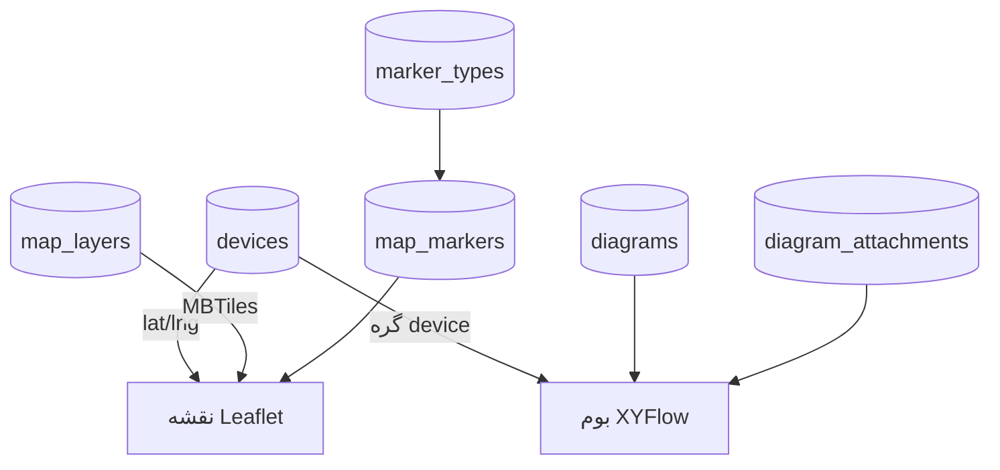
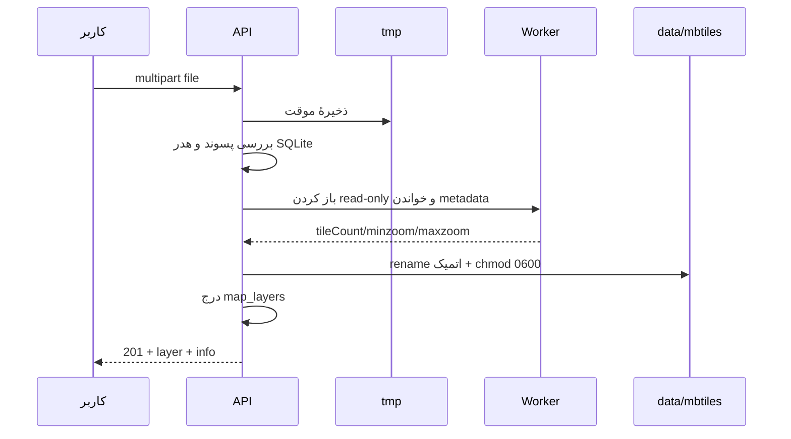

# فصل ۲۲ — نقشه، نشانه‌ها و دیاگرام شبکه

> **خلاصه:** NetWatch دو نمای مکانی/توپولوژیک دارد: نقشهٔ جغرافیایی با
> Leaflet/MapLibre و کاشی‌های آفلاین MBTiles، و بوم دیاگرام با XYFlow. این فصل
> قالب MBTiles، جریان امن آپلود، لایه‌ها، نشانه‌ها، KML، ساختار گراف،
> هم‌زمانی ویرایش و خروجی تصویری را توضیح می‌دهد.
>
> **نرم‌افزارها:** Leaflet، MapLibre GL، `@xyflow/react`، SQLite/MBTiles و
> `html-to-image`.
>
> **پیش‌نیاز:** فصل ۱۳ (UI و نقشه) و فصل ۴ (SQLite).

---

## ۱. دو مسئلهٔ متفاوت

| نما | سؤال | داده |
| --- | --- | --- |
| نقشه | «این تجهیز کجاست؟» | latitude/longitude، لایه، نشانه |
| دیاگرام | «این تجهیز به چه چیزی وصل است؟» | گراف گره/یال، نه مختصات جغرافیایی |

اشتباه رایج: برای نمایش توپولوژی از نقشه استفاده نکنید. نقشه برای موقعیت
فیزیکی است؛ دیاگرام برای ارتباط منطقی/فیزیکی. هر دو می‌توانند یک تجهیز را
نشان دهند، اما دادهٔشان یکی نیست.



---

## ۲. پشتهٔ نقشه

- **Leaflet** برای تعامل پایه، نشانگرها و پاپ‌آپ.
- **MapLibre GL** برای لایه‌های برداری و MBTiles.
- کاشی‌ها از همان Origin و پشت نشست سرو می‌شوند؛ CDN بیرونی لازم نیست.
- فونت/آیکن محلی است تا نصب آفلاین کار کند.

نقشهٔ پایه می‌تواند یکی از این‌ها باشد:

| نوع لایه | معنا |
| --- | --- |
| `builtin` | نقشهٔ سادهٔ داخلی/بدون فایل |
| `mbtiles` | فایل آفلاین |
| `empty` | بوم خالی برای overlay |

فقط یک لایه `is_default = 1` است. تغییر پیش‌فرض در یک تراکنش، ابتدا مقدار
قبلی را صفر و سپس لایهٔ جدید را پیش‌فرض می‌کند.

---

## ۳. MBTiles: چیزی بیشتر از یک فایل SQLite

MBTiles یک پایگاه‌دادهٔ SQLite با جدول‌های `metadata` و `tiles` است. NetWatch
آن را **read-only** باز می‌کند و هرگز داخل فایل اصلی نمی‌نویسد.

### ۳.۱. metadata مهم

| کلید | کاربرد |
| --- | --- |
| `name` | نام پیشنهادی |
| `format` | `png`، `jpg`، `webp`، `pbf` |
| `minzoom` / `maxzoom` | بازهٔ زوم |
| `attribution` | متن انتساب |
| `scheme` / `tile_scheme` | `tms` (پیش‌فرض) یا `xyz` |
| `json` | برای لایه‌های برداری؛ `vector_layers` |

اگر `scheme` صریحاً `xyz`/`wgs84` باشد، محور Y برعکس نمی‌شود؛ در غیر این صورت
طرح استاندارد TMS فرض می‌شود. این جزئیات باعث می‌شود نقشهٔ وارونه یا جابه‌جا
نشود.

### ۳.۲. کاشی برداری

- `format=pbf` یعنی کاشی Protobuf/MVT.
- بسیاری از کاشی‌ها gzip هستند؛ سرور بر اساس بایت‌های همان کاشی
  `Content-Encoding: gzip` می‌گذارد.
- کاشی خالی/غیرفشرده هم ممکن است وجود داشته باشد؛ بنابراین نمی‌توان فقط از
  کاشی اول نتیجه گرفت.

### ۳.۳. سرو کاشی

```http
GET /api/tiles/:layerId/:z/:x/:y
```

- بدون لایه/فایل: `404`.
- کاشی ناموجود: `404` خالی.
- `Content-Type` از metadata و امضای کاشی.
- `Cache-Control: private, max-age=86400`؛ کش مشترک ممنوع.

---

## ۴. آپلود امن MBTiles



نکات امنیتی:

1. **پسوند تنها کافی نیست.** امضای `SQLite format 3` بررسی می‌شود.
2. فایل در Worker با `readOnly` باز می‌شود؛ حتی اگر نوشتنی باشد، تغییر نمی‌کند.
3. نام نهایی کاملاً تولیدی است (`timestamp-uuid.mbtiles`)؛ نام کاربر در مسیر
   ذخیره نمی‌شود.
4. فایل نیمه‌کاره در `<DATA_DIR>/tmp` می‌ماند و Sweep بعدی پاک می‌کند.
5. سقف حجم عمداً ندارد؛ اما فضای دیسک قبل از نوشتن بررسی می‌شود.
6. اگر درج DB شکست بخورد، فایل نهایی حذف می‌شود.

### ۴.۱. API لایه‌ها

| متد | مسیر | کار |
| --- | --- | --- |
| GET | `/api/layers` | فهرست لایه‌ها + فایل‌های موجود |
| POST | `/api/layers` | ساخت لایه از فایل موجود یا empty |
| PUT | `/api/layers/:id` | ویرایش/پیش‌فرض |
| DELETE | `/api/layers/:id?removeFile=1` | حذف لایه و در صورت امکان فایل |
| POST | `/api/layers/upload` | آپلود فایل |
| GET | `/api/layers/:id/info` | metadata |
| GET | `/api/mbtiles/files` | فایل‌های بدون لایه |
| DELETE | `/api/mbtiles/files/:name` | حذف فایل |

حذف لایه با `removeFile=1` فقط وقتی فایل را پاک می‌کند که لایهٔ دیگری به آن
اشاره نکند. فایل ابتدا rename موقت می‌شود؛ اگر تراکنش DB شکست بخورد، نام
برمی‌گردد.

---

## ۵. نشانه‌های نقشه

نشانه برای چیزی است که تجهیز نیست: محل دکل، نقطهٔ نصب، اتاق، مانع، یادداشت
مکانی.

### ۵.۱. مدل

`marker_types`:

| فیلد | معنا |
| --- | --- |
| `name` | یکتا |
| `color` | رنگ |
| `icon` | نام آیکن Lucide |
| `description` | توضیح |

`map_markers`:

| فیلد | معنا |
| --- | --- |
| `type_id` | نوع؛ حذف نوع → `NULL` |
| `name` | نام |
| `latitude` / `longitude` | مختصات |
| `notes` | توضیح |
| `created_at` / `updated_at` | زمان |

### ۵.۲. ورود و خروجی

| مسیر | کار |
| --- | --- |
| `GET /api/markers/export` | Excel/CSV |
| `GET /api/markers/template` | قالب |
| `POST /api/markers/import/preview` | پیش‌نمایش |
| `POST /api/markers/import` | اعمال |
| `POST /api/markers/import/kml` | ورود KML/KMZ |

KML/KMZ با فیلد `file` و اختیاری `typeId`/`type`/`mode` ارسال می‌شود. برای
فایل‌های بزرگ، ابتدا Preview بگیرید. مختصات باید در بازهٔ معتبر باشند؛
`latitude` بین ‎-۹۰ تا ۹۰ و `longitude` بین ‎-۱۸۰ تا ۱۸۰.

---

## ۶. تجهیز روی نقشه

- `latitude`/`longitude` بخشی از `devices` هستند.
- `GET /api/devices/map` تجهیزات دارای مختصات را می‌دهد.
- `includeMissing=1` تجهیزات بدون مختصات را هم برمی‌گرداند.
- `POST /api/devices/positions` چند مختصات را یک‌جا ذخیره می‌کند.
- `GET /api/devices/export/geo` و `POST /api/devices/import/geo` برای
  ورود/خروجی دسته‌ای موقعیت.

اگر تجهیز روی نقشه نیست، اول `geo=without` را در فهرست بررسی کنید؛ احتمالاً
مختصات خالی است، نه اینکه لایه خراب باشد.

### ۶.۱. ایستگاه‌ها (Sites)

ایستگاه یک خوشهٔ مکانی است که چند تجهیز را زیر یک نام/گروه جمع می‌کند. نقشه
تجهیزات دارای `site_id` را در خوشهٔ ایستگاه نشان می‌دهد و تجهیزات بدون ایستگاه
را جداگانه.

| متد | مسیر | کار |
| --- | --- | --- |
| GET | `/api/sites` | فهرست + تعداد تجهیز |
| POST | `/api/sites` | ساخت + تخصیص تجهیزات |
| PUT | `/api/sites/:id` | ویرایش/تخصیص مجدد |
| DELETE | `/api/sites/:id` | حذف و خالی‌کردن `site_id` تجهیزات |

قواعد:

- نام الزامی است.
- `device_ids` باید حداقل یک تجهیز معتبر باشد؛ حداکثر ۱۰۰۰.
- همهٔ شناسه‌ها باید وجود داشته باشند، وگرنه کل درخواست `400` می‌شود.
- ویرایش با `device_ids` عضویت قبلی همان ایستگاه را پاک و سپس مجموعهٔ جدید را
  تخصیص می‌دهد؛ همه در یک تراکنش.
- حذف ایستگاه تجهیزات را حذف نمی‌کند؛ فقط `site_id` آن‌ها را خالی می‌کند.

---

## ۷. دیاگرام: یک گراف مستقل

هر ردیف `diagrams` شامل نام، توضیح، `parent_id` و کل گراف JSON است.

```json
{
  "nodes": [
    {
      "id": "dev-17",
      "type": "device",
      "position": { "x": 120, "y": 80 },
      "width": 180,
      "height": 72,
      "data": { "deviceId": 17 }
    }
  ],
  "edges": [
    {
      "id": "e-1",
      "source": "dev-17",
      "target": "dev-18",
      "kind": "fiber",
      "label": "فیبر اصلی"
    }
  ]
}
```

### ۷.۱. محدودیت‌ها

| مورد | سقف/مقدار |
| --- | --- |
| گره | ۸۰۰ |
| یال | ۱۶۰۰ |
| حجم JSON | ۴ مگابایت |
| نوع گره | `device`، `shape`، `note`، `group`، `image`، `diagram` |
| نوع ارتباط | `fiber`، `otn`، `copper`، `bandwidth`، `radio`، `modem` |
| سمت اتصال | `top`، `right`، `bottom`، `left` |

شناسهٔ گره/یال باید یکتا و حداکثر ۸۰ نویسه باشد. اتصال گره به خودش مجاز
نیست. دو سر یال باید روی بوم موجود باشند.

### ۷.۲. درخت دیاگرام‌ها

`parent_id` ساختار درختی می‌سازد. حذف یک والد، فرزندان را Cascade حذف
می‌کند. برای جلوگیری از حلقه، `normalizeParent` والد را بررسی می‌کند و یک
دیاگرام نمی‌تواند والد خودش یا فرزند خودش باشد.

### ۷.۳. هم‌زمانی و Revision

هر ذخیره `revision` فعلی را می‌فرستد. اگر سرور نسخهٔ جدیدتری داشته باشد:

```http
409 Conflict
```

این کار از بازنویسی تغییرات تب دیگر جلوگیری می‌کند. در UI باید پیام «نسخهٔ
جدیدتر وجود دارد» نمایش داده شود، نه اینکه تغییرات کاربر بی‌صدا دور ریخته
شود.

### ۷.۴. اتصال متقابل

وقتی یک دستگاه به دیاگرام دیگر وصل می‌شود، سرور ارتباط متقابل را در دیاگرام
مقصد می‌سازد. `syncReciprocalLinks` تفاوت گراف قبلی/جدید را حساب می‌کند و
برای هر یال، طرف مقابل را به‌روز می‌کند. حذف یک طرف باید طرف دیگر را هم پاک
کند. `pruneBrokenDiagramLinks` در شروع سرور یال‌های یتیم را جمع می‌کند.

---

## ۸. پیوست تصویری دیاگرام

`diagram_attachments` همان سامانهٔ پیوست تجهیزات را با مالکیت دیاگرام استفاده
می‌کند.

| مسیر | کار |
| --- | --- |
| `GET /api/diagrams/:id/attachments` | فهرست |
| `POST /api/diagrams/:id/attachments` | آپلود تصویر |
| `GET /api/diagrams/:id/attachments/:attachmentId/download` | دانلود |
| `DELETE /api/diagrams/:id/attachments/:attachmentId` | حذف |

فقط تصویر برای بوم مجاز است. فایل در `<DATA_DIR>/attachments` ذخیره می‌شود و
نام نمایشی امن می‌شود. حذف دیاگرام ردیف‌ها را Cascade می‌کند و فایل در Sweep
بعدی پاک می‌شود.

---

## ۹. سمت رابط کاربری

| فایل | مسئولیت |
| --- | --- |
| `pages/MapPage.tsx` | نقشه، لایه‌ها، نشانگرها، فیلتر |
| `pages/Diagrams.tsx` | فهرست/درخت و انتخاب دیاگرام |
| `features/diagrams/DiagramCanvas.tsx` | بوم XYFlow |
| `DiagramToolbar.tsx` | ابزارها، undo/redo، خروجی |
| `DiagramInspector.tsx` | ویرایش گره/یال |
| `DiagramTree.tsx` | ساختار درختی |
| `lib/diagram-geometry.ts` | مسیر و هندسهٔ اتصال |
| `lib/diagram-export.ts` | PNG/SVG |

`useCanvasHistory` تاریخچهٔ محلی برای undo/redo دارد. این تاریخچه با
`revision` سرور فرق دارد: undo محلی می‌تواند به نسخهٔ قدیمی برگردد، اما ذخیره
باید revision جدید را بفرستد.

---

## ۱۰. خطاهای رایج

| نشانه | علت | رفع |
| --- | --- | --- |
| نقشه سفید | لایهٔ پیش‌فرض فایل ندارد | `/api/layers` و `info` |
| کاشی ۴۰۴ | z/x/y یا scheme اشتباه | metadata و TMS/XYZ |
| نقشه وارونه | scheme صریح نشده | `scheme=xyz` در metadata |
| MBTiles رد می‌شود | هدر SQLite یا metadata خراب | فایل را با `sqlite3` بررسی کنید |
| نشانه دیده نمی‌شود | نوع/مختصات/فیلتر | `GET /api/markers` |
| دیاگرام ۴۰۹ | تب دیگر ذخیره کرده | Reload و ادغام |
| یال یتیم | گره حذف شده | `pruneBrokenDiagramLinks` |
| تصویر بوم خالی | فونت/آیکن یا CORS محلی | خروجی PNG و کنسول |

---

## ۱۱. آزمون‌های مرتبط

```bash
env -u PORT node --experimental-strip-types --test server/tests/unit/mbtiles-layers.test.mjs
env -u PORT node --experimental-strip-types --test server/tests/integration/map.test.mjs
env -u PORT node --experimental-strip-types --test server/tests/integration/mbtiles-layers.test.mjs
env -u PORT node --experimental-strip-types --test server/tests/integration/diagrams.test.mjs
env -u PORT node --experimental-strip-types --test server/tests/integration/diagram-links.test.mjs
env -u PORT node --experimental-strip-types --test web/tests/diagram-geometry.test.ts
```

برای تغییر در دیاگرام، حداقل تست کنید:

- گره تکراری/یال به گره ناموجود؛
- سقف ۸۰۰/۱۶۰۰؛
- حذف والد و Cascade؛
- revision قدیمی → ۴۰۹؛
- اتصال متقابل و حذف یک طرف.

---

## ۱۲. تمرین

1. یک فایل MBTiles کوچک آپلود کنید و `metadata` آن را ببینید.
2. یک فایل `.mbtiles` جعلی (متن ساده) آپلود کنید؛ باید `400` بگیرد.
3. لایه را پیش‌فرض کنید و سپس لایهٔ دیگری را پیش‌فرض کنید؛ فقط یکی باید
   `is_default=1` باشد.
4. سه نشانه با نوع‌های مختلف بسازید و از KML وارد کنید.
5. یک دیاگرام با ۳ گره و ۲ یال بسازید؛ سپس در دو تب هم‌زمان ذخیره کنید و
   ۴۰۹ را ببینید.
6. یک دیاگرام فرزند بسازید، والد را حذف کنید و بررسی کنید فرزند هم حذف شده
   است.

---

## ۱۳. چک‌لیست پایان فصل

- [ ] تفاوت نقشه و دیاگرام را می‌دانم.
- [ ] ساختار MBTiles و TMS/XYZ را می‌فهمم.
- [ ] جریان امن آپلود را می‌شناسم.
- [ ] لایهٔ پیش‌فرض و حذف فایل را بلدم.
- [ ] نشانه‌ها و ورود KML را می‌دانم.
- [ ] ساختار گراف و محدودیت‌ها را می‌فهمم.
- [ ] revision و اتصال متقابل را می‌شناسم.
- [ ] تست‌های مرتبط را اجرا کرده‌ام.

**فصل بعد:** [خزانهٔ اعتبارنامه و حسابرسی](23-credentials-audit.md)
