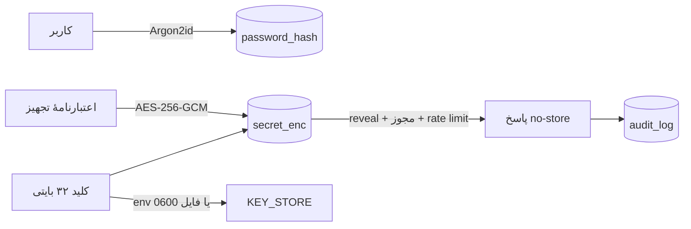

# فصل ۲۳ — خزانهٔ اعتبارنامه و حسابرسی

> **خلاصه:** NetWatch رمز تجهیزات را نه برای احراز هویت کاربر، بلکه برای
> دسترسی عملیاتی نگه می‌دارد؛ بنابراین هش کردن یک‌طرفه کافی نیست. این فصل
> رمزنگاری AES-256-GCM، چرخهٔ کلید، تفکیک مجوز read/write/reveal، سقف نرخ،
> سنجش قدرت، بررسی افشا و رکورد حسابرسی را توضیح می‌دهد.
>
> **نرم‌افزارها:** `node:crypto`، Argon2 (برای رمز کاربران)، SQLite و Express.
>
> **پیش‌نیاز:** فصل ۸ (Auth/RBAC)، فصل ۱۵ (امنیت) و فصل ۴ (DB).

---

## ۱. دو نوع رمز، دو سیاست

| نوع | نمونه | ذخیره | قابل بازیابی؟ |
| --- | --- | --- | --- |
| رمز ورود کاربر | رمز `admin` | هش Argon2id | خیر |
| رمز دسترسی تجهیز | SSH/پنل سوئیچ | AES-256-GCM | بله، با مجوز reveal |

این تفکیک بنیادی است. رمز کاربر هرگز نباید قابل بازیابی باشد؛ رمز تجهیز باید
برای اپراتور مجاز نمایش داده شود. اگر این دو را یکی کنید، یا امنیت را از دست
می‌دهید یا قابلیت را.



---

## ۲. رمزنگاری: قالب و کلید

### ۲.۱. الگوریتم

- `AES-256-GCM`
- IV تصادفی ۱۲ بایتی برای هر مقدار
- auth tag ۱۶ بایتی
- AAD برای اعتبارنامه‌های خزانه: `cred:<id>`
- قالب ذخیره: `v1:iv:tag:ciphertext` یا `v2:iv:tag:ciphertext`

`v1` برای دادهٔ قدیمی تجهیزات (بدون AAD) و `v2` برای خزانه (با AAD) است.
AAD از «کپی ciphertext یک ردیف به ردیف دیگر» جلوگیری می‌کند؛ رمزگشایی ردیف
اشتباه شکست می‌خورد.

```js
const iv = crypto.randomBytes(12);
const cipher = crypto.createCipheriv('aes-256-gcm', key, iv);
if (aad) cipher.setAAD(Buffer.from(aad, 'utf8'));
const ciphertext = Buffer.concat([cipher.update(value, 'utf8'), cipher.final()]);
const tag = cipher.getAuthTag();
```

### ۲.۲. کلید از کجا می‌آید؟

| منبع | شرط | نکته |
| --- | --- | --- |
| `NETWATCH_CREDENTIAL_KEY` | hex ۶۴ نویسه یا base64 ۳۲ بایت | اولویت اول؛ مناسب تولید |
| `<DATA_DIR>/device-credentials.key` | ساختهٔ خودکار با مجوز `0600` | برای نصب ساده |

اگر env تنظیم شده باشد، فایل خوانده نمی‌شود. اگر نه، فایل یک‌بار با `wx`
ساخته می‌شود؛ `wx` از بازنویسی هم‌زمان توسط فرآیند دیگر جلوگیری می‌کند.
کلید هرگز در DB یا لاگ نوشته نمی‌شود.

### ۲.۳. چرخهٔ کلید

- **گم شدن کلید = گم شدن رمزهای قابل بازیابی.** backup باید کلید را جداگانه
  نگه دارد.
- **تغییر کلید بدون re-encrypt** دادهٔ قبلی را غیرقابل خواندن می‌کند.
- برای چرخش، ابتدا همهٔ مقادیر را با کلید قدیم decrypt و با کلید جدید encrypt
  کنید؛ سپس کلید را عوض کنید.
- `resetCredentialKeyCache()` پس از بازیابی فایل کلید لازم است تا فرآیند
  کلید کش‌شدهٔ قبلی را نگه ندارد.

---

## ۳. مدل داده

`credentials`:

| ستون | معنا |
| --- | --- |
| `device_id` | اتصال اختیاری به تجهیز (`SET NULL` با حذف) |
| `label` | نام/عنوان |
| `kind` | نوع: `ssh`، `https`، `telnet`، `snmp`، `console`، `wifi`، `api`، `database`، `mail`، `other` |
| `username_enc` | نام کاربری رمزنگاری‌شده |
| `secret_enc` | رمز رمزنگاری‌شده |
| `notes_enc` | یادداشت رمزنگاری‌شده |
| `host` / `port` | مقصد |
| `tags` | برچسب متنی |
| `strength` | امتیاز ۰ تا ۴ |
| `weak_reasons` | JSON دلایل ضعف |
| `last_rotated_at` | آخرین چرخش |
| `rotate_every_days` | دورهٔ چرخش |
| `created_by` / `updated_by` | مسئول |

رمزها در فهرست و جزئیات **برنمی‌گردند**. تنها مسیر `/:id/reveal` و خروجی
Excel می‌توانند مقدار خام را بدهند.

---

## ۴. سه مجوز، سه سطح خطر

| مجوز | چه کاری | پیش‌فرض |
| --- | --- | --- |
| `credentials:read` | فهرست، جزئیات، checkup | Admin/Operator |
| `credentials:write` | ساخت، ویرایش، حذف، تولید، import | Admin/Operator |
| `credentials:reveal` | دیدن رمز و خروجی خام | فقط Admin؛ قابل اعطا به کاربر |

`reveal` تنها مجوز قابل تفویض جدا از نقش است (`DELEGABLE_PERMISSIONS`). یک
Operator می‌تواند رکورد بسازد و رمز را وارد کند، اما بدون مجوز صریح آن را
نمی‌بیند.

```js
router.get('/:id/reveal',
  requirePermission('credentials:reveal'),
  revealLimiter,
  handler
);
```

> پنهان‌کردن دکمه در UI کافی نیست. سرور برای هر سه سطح بررسی می‌کند.

---

## ۵. مسیرهای API

| متد | مسیر | کار |
| --- | --- | --- |
| GET | `/api/credentials` | فهرست با فیلتر `search`، `deviceId`، `kind`، `weak`، `due`، `sort` |
| GET | `/api/credentials/summary` | خلاصهٔ خزانه |
| GET | `/api/credentials/kinds` | انواع و محدودیت‌های تولید |
| GET | `/api/credentials/checkup` | ضعیف/تکراری/افشاشده |
| GET | `/api/credentials/export?format=xlsx` | خروجی خام |
| GET | `/api/credentials/:id` | جزئیات بدون رمز |
| GET | `/api/credentials/:id/reveal` | رمز خام |
| POST | `/api/credentials` | ساخت |
| PATCH | `/api/credentials/:id` | ویرایش |
| POST | `/api/credentials/:id/rotated` | ثبت چرخش |
| DELETE | `/api/credentials/:id` | حذف |
| POST | `/api/credentials/generate` | تولید رمز/عبارت |
| POST | `/api/credentials/import` | ورود Excel/CSV |
| POST | `/api/credentials/import-devices` | انتقال یک‌بارهٔ رمز تجهیزات |
| POST | `/api/credentials/recheck` | بازمحاسبهٔ قدرت (Admin) |

### ۵.۱. سقف نرخ

| عملیات | سقف |
| --- | --- |
| `reveal` | ۴۰ بار در ۶۰ ثانیه برای هر حساب |
| `export` | ۶ بار در ۶۰ ثانیه برای هر حساب |

این سقف حتی برای حساب مجاز هم اعمال می‌شود تا خزانه پشت‌سرهم خالی نشود.
پاسخ `429` را با احترام به `Retry-After` دوباره امتحان کنید.

### ۵.۲. هدرهای پاسخ حساس

```http
Cache-Control: no-store
Pragma: no-cache
X-Content-Type-Options: nosniff
```

هیچ پروکسی/کش مشترکی نباید رمز را نگه دارد. خروجی Excel نیز `no-store` است.

---

## ۶. سنجش قدرت رمز

`assessSecret` امتیاز ۰ تا ۴ می‌دهد:

| آنتروپی | امتیاز پایه |
| --- | ---: |
| < ۲۶ بیت | ۰ |
| < ۴۲ | ۱ |
| < ۶۲ | ۲ |
| < ۸۴ | ۳ |
| ≥ ۸۴ | ۴ |

سپس جریمه‌ها اعمال می‌شوند: رمز کوتاه، الگوی تکراری، شامل نام/میزبان/برچسب،
دنبالهٔ قابل حدس، کاراکتر تکراری و مانند آن. نتیجه ممکن است به ۰ یا ۱ کاهش
یابد. `weak` یعنی امتیاز ≤ ۱.

### ۶.۱. Checkup

`GET /api/credentials/checkup` سه مسئله را جدا می‌کند:

| مسئله | معنا |
| --- | --- |
| `weak` | امتیاز ≤ ۱ |
| `reused` | همان رمز در بیش از یک ردیف |
| `breached` | رمز در فهرست رمزهای افشاشدهٔ داخلی |

خروجی شامل `checked`، `weak`، `reused`، `breached`، `secure`، `unreadable` و
فهرست `items` است. `unreadable` یعنی رمزگشایی ممکن نشده (کلید/AAD) و باید
جدی گرفته شود.

---

## ۷. تولید رمز و عبارت عبور

`POST /api/credentials/generate`

| گزینه | بازه/پیش‌فرض |
| --- | --- |
| `mode` | `password` یا `passphrase` |
| `length` | ۸ تا ۱۲۸؛ پیش‌فرض ۲۰ |
| `lower/upper/digits/symbols` | مجموعه‌های نویسه |
| `avoidAmbiguous` | پیش‌فرض true |
| `requireEach` | پیش‌فرض true |
| `words` | ۳ تا ۱۲؛ پیش‌فرض ۶ |
| `separator` | `-`، `.`، `_`، ` ` |
| `addNumber` / `capitalize` | اختیاری |
| `unique` | پیش‌فرض true |

«یکتا» یعنی رمز تولیدی با رمزهای موجود مقایسه می‌شود؛ حداکثر ۱۲ تلاش برای
تولید غیرتکراری انجام می‌شود. اگر باز هم تکراری بود، `unique: false` برمی‌گردد
و UI باید هشدار بدهد.

---

## ۸. ورود، خروجی و چرخش

### ۸.۱. ورود گروهی

فایل Excel/CSV با `multipart/form-data` و فیلد `file`. هر ردیف مستقل ثبت
می‌شود؛ یک ردیف خراب کل فایل را برنمی‌گرداند. ستون‌ها با کلیدهای فارسی/انگلیسی
نرمال می‌شوند.

### ۸.۲. خروجی

خروجی خام فقط با `credentials:reveal`، سقف ۶ بار در دقیقه و `no-store`.
نام فایل `netwatch-passwords-YYYYMMDD.xlsx` است. این فایل را در پوشهٔ مشترک
نگه ندارید؛ پس از استفاده حذف کنید.

### ۸.۳. چرخش

`POST /api/credentials/:id/rotated` تاریخ چرخش را ثبت می‌کند و می‌تواند
`rotateEveryDays` را به‌روز کند. فیلتر `due` رکوردهایی را نشان می‌دهد که
`COALESCE(last_rotated_at, created_at)` آن‌ها قدیمی‌تر از دوره است. این فقط
یادآوری است؛ NetWatch رمز تجهیز را خودکار عوض نمی‌کند.

---

## ۹. حسابرسی: چه چیزی و چگونه ثبت می‌شود؟

`auditMutations` بعد از `attachUser` و پیش از گاردهای مجوز نصب می‌شود؛ بنابراین
درخواست‌های ردشده هم ثبت می‌شوند.

| رویداد | action |
| --- | --- |
| ورود/خروج | `auth.login`، `auth.logout` |
| مدیریت کاربر | `user.manage` |
| تغییر تنظیمات | `settings.update` |
| نمایش رمز | `credential.reveal` |
| خروجی رمز | `credential.export` |
| بازیابی | `backup.restore` |
| Retention | `retention.run` |
| Probe | `probe.run` / `probe.ping` |
| خروجی داده | `data.export` |

### ۹.۱. چه چیزی ذخیره نمی‌شود؟

- مقدار رمز، توکن، CSRF و کوکی؛
- هدر Authorization؛
- کلید API؛
- مسیر فایل حساس.

فقط **نام کلیدهای بدنه** و شناسهٔ هدف ثبت می‌شود. `sanitizeLogText` متن را
پاک می‌کند و `capJson` جزئیات را به ۴۰۰۰ نویسه محدود می‌کند.

### ۹.۲. خواندن Audit

```bash
curl -s -b cookies.txt \
  'http://127.0.0.1:8787/api/audit?page=1&pageSize=50&action=credential.reveal'
```

فیلترها: `action`، `username`، `success` (`0/1`)، `from`، `to`، `page`،
`pageSize` (حداکثر ۱۰۰). فقط Administrator مجاز است.

### ۹.۳. نگه‌داری

`audit_retention_days` پیش‌فرض ۱۸۰ روز است و بین ۷ تا ۳۶۵۰ محدود می‌شود.
Sweeper روزانه رکوردهای قدیمی‌تر را پاک می‌کند. اگر Audit برای انطباق مهم است،
قبل از کوتاه‌کردن دوره، خروجی و آرشیو بیرونی داشته باشید.

---

## ۱۰. سمت رابط کاربری

| فایل | کار |
| --- | --- |
| `pages/Credentials.tsx` | فهرست، فیلتر، summary، checkup |
| `features/credentials/CredentialForm.tsx` | ساخت/ویرایش |
| `CredentialDetail.tsx` | جزئیات و reveal |
| `PasswordGenerator.tsx` | تولید رمز |
| `StrengthMeter.tsx` | نمایش امتیاز |
| `CheckupPanel.tsx` | مسائل امنیتی |
| `ImportExportDialog.tsx` | ورود/خروجی |

الگوی reveal:

1. دکمه فقط با `can('credentials:reveal')` دیده شود.
2. پاسخ در state محلی نگه داشته شود، نه در localStorage.
3. پس از بستن مودال/تغییر صفحه پاک شود.
4. خطای `DECRYPT_FAILED` پیام مشخص داشته باشد.

---

## ۱۱. خطاهای رایج

| نشانه | علت | رفع |
| --- | --- | --- |
| `403` روی reveal | مجوز اختصاصی ندارد | Admin آن را بدهد |
| `429` | سقف reveal/export | صبر و تلاش دوباره |
| `DECRYPT_FAILED` | کلید/AAD عوض شده | کلید درست را برگردانید |
| `unreadable` در checkup | ردیف با کلید قدیم | re-encrypt یا حذف |
| خروجی خالی | فیلتر/مجوز | بررسی query و permission |
| Audit پر است | رویدادهای تکراری | دورهٔ نگه‌داری و فیلتر |

---

## ۱۲. آزمون‌های مرتبط

```bash
env -u PORT node --experimental-strip-types --test server/tests/unit/credentials-strength.test.mjs
env -u PORT node --experimental-strip-types --test server/tests/integration/credentials-api.test.mjs
env -u PORT node --experimental-strip-types --test server/tests/integration/security.test.mjs
env -u PORT node --experimental-strip-types --test server/tests/integration/rbac-matrix.test.mjs
env -u PORT node --experimental-strip-types --test server/tests/unit/logger.test.mjs
```

موارد الزامی برای تست:

- Operator بدون reveal → 403؛
- reveal با مجوز → 200 و `no-store`؛
- export بیش از سقف → 429؛
- کلید اشتباه → خطای رمزگشایی، نه دادهٔ خراب؛
- Audit بدون مقدار حساس؛
- checkup برای رمز تکراری/ضعیف.

---

## ۱۳. تمرین

1. یک اعتبارنامه بسازید و بررسی کنید پاسخ فهرست فیلد رمز ندارد.
2. با نقش Operator رمز را reveal کنید؛ باید 403 بگیرید.
3. مجوز `credentials:reveal` را به همان کاربر بدهید و دوباره تست کنید.
4. ۴۱ بار reveal بزنید و `429` را ببینید.
5. یک رمز تکراری در دو ردیف بسازید و checkup را بگیرید.
6. Audit را فیلتر کنید و مطمئن شوید مقدار رمز در `details` نیست.
7. فایل کلید را در محیط تست عوض کنید و رفتار `DECRYPT_FAILED` را ببینید.

---

## ۱۴. چک‌لیست پایان فصل

- [ ] تفاوت رمز کاربر و رمز تجهیز را می‌دانم.
- [ ] AES-GCM، IV، tag و AAD را می‌فهمم.
- [ ] منبع کلید و خطر گم‌شدن آن را می‌شناسم.
- [ ] سه مجوز credentials را بلدم.
- [ ] سقف reveal/export را می‌دانم.
- [ ] امتیاز قدرت و checkup را می‌فهمم.
- [ ] چرخش رمز را از تغییر خودکار تفکیک می‌کنم.
- [ ] Audit چه چیزی را ذخیره نمی‌کند، می‌دانم.
- [ ] تست‌های امنیتی مرتبط را اجرا کرده‌ام.

**فصل بعد:** [مدیریت، سلامت و عملیات پیشرفته](24-admin-operations-health.md)
