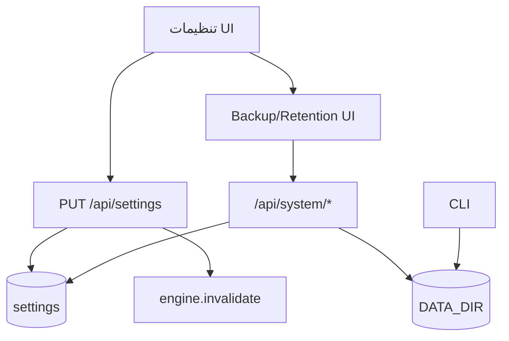

# فصل ۲۴ — مدیریت، سلامت و عملیات پیشرفته

> **خلاصه:** این فصل برای کسی است که NetWatch را «اداره» می‌کند: تنظیمات،
> کاربران، سلامت اجزا، پشتیبان/بازیابی، Retention، Audit و سناریوهای خرابی.
> تمرکز روی رابطهٔ UI، API و فایل‌های `DATA_DIR` است، نه تکرار دستورهای نصب.
>
> **نرم‌افزارها:** Express، SQLite، systemd/پروکسی و ابزارهای CLI پروژه.
>
> **پیش‌نیاز:** فصل‌های ۱۱ (Backup)، ۱۲ (Retention)، ۱۵ (امنیت) و ۱۷ (استقرار).

---

## ۱. سه سطح مدیریت

| سطح | ابزار | نمونه |
| --- | --- | --- |
| تنظیمات محصول | UI `/settings` و `PUT /api/settings` | بازه، آستانه، نام سایت |
| مدیریت داده | API `/api/system/*` | Backup، Restore، Retention |
| مدیریت فرآیند | systemd/CLI | Start/Stop، TLS، ارتقا |

قاعدهٔ طلایی: **برای تغییر داده از API/CLI رسمی استفاده کنید.** `sqlite3` دستی
برای عیب‌یابی خوب است، اما نوشتن مستقیم در جدول‌ها می‌تواند کش موتور،
`next_check_at`، `revision` دیاگرام و سازگاری Migration را بشکند.



---

## ۲. تنظیمات: گروه‌ها و اثر واقعی

صفحهٔ تنظیمات یازده بخش دارد:

| گروه | بخش‌ها |
| --- | --- |
| پایه | عمومی، نمایش و نقشه |
| پایش و نگهداری | موتور مانیتورینگ، علت‌ها و اقدامات |
| داده و دارایی | گروه‌ها، تگ‌ها، انواع تجهیزات، لایه‌های نقشه، چیدمان ویجت‌ها |
| سیستم | داده‌ها و نگهداری، کاربران |

### ۲.۱. تنظیمات مهم

| کلید | اثر |
| --- | --- |
| `site_name` | نام نمایشی |
| `timezone_offset_minutes` | مرز روز و تقویم |
| `calendar` | `jalali` یا `gregorian` |
| `ping_interval` | بازهٔ پیش‌فرض Probe |
| `timeout_ms` | timeout پیش‌فرض |
| `retries` | تلاش مجدد |
| `latency_threshold` | آستانهٔ تأخیر |
| `loss_threshold` | آستانهٔ افت بسته |
| `alerting_enabled` | کلید هشدار |
| `alert_delay` | تأخیر عمومی هشدار |
| `alert_cooldown` | cooldown عمومی |
| `suppression_enabled` | ساعات سکوت |
| `suppression_start` / `suppression_end` | بازهٔ سکوت |
| `engine_mode` | `auto`/`icmp`/`tcp`/`simulate` |
| `probe_allowed_cidrs` | محدودهٔ مجاز Probe |
| `attachment_max_mb` | سقف پیوست (۱ تا ۵۰) |
| `backup_*` | سیاست پشتیبان |
| `retention_*` | سیاست هرس |
| `audit_retention_days` | نگه‌داری Audit |
| `dashboard_widgets` / `device_detail_widgets` | چیدمان |
| `dashboard_auto_refresh` | تازه‌سازی خودکار |

### ۲.۲. قفل محیطی

اگر یک کلید با متغیر محیطی قفل شده باشد، `PUT /api/settings` آن را تغییر
نمی‌دهد و مقدار مؤثر env باقی می‌ماند. این رفتار عمدی است: اپراتور UI نباید
بتواند سیاست امنیتی تعیین‌شده توسط تیم زیرساخت را دور بزند.

### ۲.۳. ذخیرهٔ بخشی

UI فقط کلیدهای همان تب را می‌فرستد و تغییرات ذخیره‌نشده را با نقطهٔ زرد نشان
می‌دهد. اگر تنظیمات ذخیره نمی‌شود:

1. کنسول/Network را ببینید: `403` یعنی مجوز `settings:write` نیست.
2. `400` یعنی مقدار خارج از بازه است؛ پیام سرور را بخوانید.
3. اگر مقدار قدیمی برگشت، احتمالاً env آن را قفل کرده است.

---

## ۳. کاربران و نشست‌ها

| نقش | توان |
| --- | --- |
| Administrator | همهٔ مجوزها، کاربران، Audit، Backup/Restore |
| Operator | عملیات روزمره؛ بدون reveal پیش‌فرض |
| Viewer | فقط خواندن |

قواعد:

- نام کاربری یکتاست.
- رمز با `password-policy.js` بررسی می‌شود.
- تغییر رمز، همهٔ نشست‌های آن کاربر را می‌بندد.
- قفل حساب پس از تلاش‌های ناموفق، با `POST /auth/users/:id/unlock` باز می‌شود.
- حذف کاربر، نشست‌های او را بی‌اعتبار می‌کند.
- مجوز اختصاصی فقط `credentials:reveal` است.

```bash
CSRF=$(awk '/nw_csrf/ {print $7}' cookies.txt)

curl -s -b cookies.txt http://127.0.0.1:8787/api/auth/users
curl -s -b cookies.txt -X POST http://127.0.0.1:8787/api/auth/users \
  -H 'Content-Type: application/json' -H "X-CSRF-Token: $CSRF" \
  -d '{"username":"ops1","password":"<رمز-قوی>","role":"operator"}'
```

---

## ۴. سلامت: چهار نما

| مسیر | مخاطب | محتوا |
| --- | --- | --- |
| `GET /health` | Load balancer | `{ok,status,ts}` |
| `GET /api/health` | Probe داخلی | همان |
| `GET /api/system/health` | Operator/Admin | اجزا، DB، موتور، صف، SSE، Job |
| `GET /api/system/app-health` | Operator/Admin | منابع برنامه + تاریخچهٔ کوتاه |
| `GET /api/system/db/health` | Operator/Admin | DB/WAL/disk/backup/retention (کش ۳۰s) |

### ۴.۱. پاسخ عمومی

```json
{ "ok": true, "status": "ok", "ts": 1761000000000 }
```

این مسیر هیچ نسخه، مسیر، نام کاربر یا جزئیات موتور را افشا نمی‌کند.

### ۴.۲. سلامت تفصیلی

اگر `ok=false` باشد، وضعیت HTTP `503` است. بخش‌های معمول:

- `db`: quick_check، WAL، اندازه، فضای دیسک؛
- `engine`: running/leader/stale/backlog؛
- `sse`: تعداد اتصال و drop؛
- `jobs`: queued/running/rejected؛
- `probes`: ظرفیت و in-flight؛
- `backup` / `retention`: آخرین اجرا.

`engine.stale` یعنی آخرین چرخه بیش از سه بازه + ۵ ثانیه کهنه است. این با
`running=false` فرق دارد: موتور می‌تواند روشن باشد اما چرخه‌اش گیر کرده باشد.

---

## ۵. پشتیبان‌گیری از UI

صفحهٔ «داده‌ها و نگهداری» می‌تواند:

- پشتیبان بسازد؛
- فهرست و اندازه را ببیند؛
- Verify کند؛
- Prune کند؛
- Restore کند.

### ۵.۱. API

| متد | مسیر | مجوز |
| --- | --- | --- |
| GET | `/api/system/backups` | `system:health` |
| POST | `/api/system/backups` | Admin |
| POST | `/api/system/backups/verify` | Admin |
| POST | `/api/system/backups/prune` | Admin |
| POST | `/api/system/backups/restore` | Admin |
| GET | `/api/system/restore/status` | `system:health` |

### ۵.۲. قاعدهٔ Restore

1. نام پشتیبان باید با الگوی `netwatch-YYYYMMDD-HHMMSS-xxxxxx` بخواند.
2. مسیر باید داخل `BACKUP_DIR` باشد؛ Path Traversal رد می‌شود.
3. موتور پیش از جای‌گذاری فایل متوقف می‌شود.
4. پس از بازیابی، اگر موتور قبلاً روشن بود، دوباره start می‌شود.
5. `dryRun=true` فقط بررسی می‌کند.

هرگز فایل DB را زیر سرویس روشن کپی نکنید. برای بازیابی دستی، سرویس را متوقف
کنید و از `npm run db:restore` استفاده کنید.

---

## ۶. Retention از UI

| متد | مسیر | کار |
| --- | --- | --- |
| GET | `/api/system/retention` | وضعیت/سیاست مؤثر |
| POST | `/api/system/retention/run` | اجرا یا Dry-Run |
| POST | `/api/system/retention/stop` | توقف بین Batchها |
| GET | `/api/system/retention/runs` | تاریخچه |

قواعد:

- اجرای هم‌زمان `409` می‌دهد.
- `dryRun=true` فقط شمارش می‌کند.
- `force=true` برای عبور از Preflight است و باید آگاهانه باشد.
- Stop فوری نیست؛ پس از Batch فعلی اعمال می‌شود.
- Preflight اگر فضای دیسک/یکپارچگی کافی نباشد، اجرا را متوقف می‌کند.

```bash
curl -s -b cookies.txt -X POST http://127.0.0.1:8787/api/system/retention/run \
  -H 'Content-Type: application/json' -H "X-CSRF-Token: $CSRF" \
  -d '{"dryRun":true}'
```

---

## ۷. سنجه‌های برنامه

`app-health` شامل:

- حافظهٔ RSS، heap، external؛
- event loop delay (p50/p95/p99)؛
- اندازهٔ DB و WAL؛
- top queries؛
- engine running/leader/mode/inflight؛
- SSE clients/dropped؛
- jobs queued/running/rejected؛
- backup/retention آخرین وضعیت.

`ok` برنامه وقتی false می‌شود که RSS ≥ ۲GiB یا event loop p99 ≥ ۱۰۰۰ms باشد.
این آستانه برای هشدار زودهنگام است، نه SLA.

---

## ۸. سناریوهای بازیابی

### ۸.۱. سرویس بالا نمی‌آید

```bash
npm run db:doctor
npm run db:doctor -- --json
```

اگر DB خراب است:

```bash
# سرویس را متوقف کنید، سپس:
npm run db:restore -- --name <backup-name> --force
npm start
```

### ۸.۲. دیسک پر شده

1. `GET /api/system/db/health` → `disk`.
2. پشتیبان‌های قدیمی را Prune کنید.
3. فایل‌های موقت `tmp` را بررسی کنید.
4. لاگ‌های بزرگ را بچرخانید.
5. در صورت نیاز Retention را با Dry-Run بررسی و سپس اجرا کنید.

هرگز برای آزادکردن فضا `netwatch.db-wal` را دستی حذف نکنید.

### ۸.۳. موتور عقب است

- `engine.stale=true` یا `backlog` بالا.
- `max_workers` و `ping_interval` را متناسب کنید.
- `probe_allowed_cidrs` را بررسی کنید.
- اگر موتور مستقل است، فقط یک رهبر باید فعال باشد.
- `POST /api/engine/control/pause` و سپس `resume` برای توقف کنترل‌شده.

### ۸.۴. ورود قفل شده

- `POST /api/auth/users/:id/unlock` با Admin.
- اگر Admin هم قفل است، از دسترسی مستقیم DB فقط در آخرین راه‌حل استفاده
  کنید؛ ابتدا backup بگیرید.
- پس از بازکردن، رمز را از طریق API عوض کنید تا نشست‌های قبلی بسته شوند.

### ۸.۵. Backup ناموفق

- `disk` و `permissions` را ببینید.
- `verify` را روی آخرین پشتیبان اجرا کنید.
- اگر manifest/checksum خراب است، آن را حذف/آرشیو کنید و پشتیبان تازه بسازید.
- کلید اعتبارنامه را جداگانه نگه دارید؛ بدون آن رمزهای خزانه قابل بازیابی
  نیستند.

---

## ۹. چرخهٔ کارهای دوره‌ای

| دوره | کار |
| --- | --- |
| روزانه | health، هشدارهای فعال، فضای دیسک، آخرین Backup |
| هفتگی | Audit مشکوک، Checkup رمزها، اندازهٔ DB/WAL |
| ماهانه | Restore آزمایشی روی محیط جدا، Prune، بازبینی Retention |
| هر انتشار | Migration، Backup پیش از ارتقا، Verify، Smoke |

Restore آزمایشی را روی همان `DATA_DIR` تولیدی انجام ندهید. یک نسخهٔ موقت با
`NETWATCH_DATA_DIR=/tmp/nw-restore-test` بسازید.

---

## ۱۰. خطاهای رایج مدیریتی

| نشانه | علت | رفع |
| --- | --- | --- |
| تنظیمات ذخیره نمی‌شود | env قفل کرده | مقدار env را عوض کنید |
| Restore ۴۰۴ | نام پشتیبان نامعتبر | از فهرست Backups انتخاب کنید |
| Restore ۴۰۰ | مسیر بیرون BACKUP_DIR | فقط نام معتبر |
| Retention ۴۰۹ | اجرای هم‌زمان | صبر یا Stop |
| health ۵۰۳ | DB/موتور ناسالم | بخش `ok=false` را بخوانید |
| Audit خالی | مجوز/دوره | `audit:read` و بازه |
| کاربر حذف نمی‌شود | آخرین Admin | ابتدا Admin دیگر بسازید |

---

## ۱۱. آزمون‌های مرتبط

```bash
env -u PORT node --experimental-strip-types --test server/tests/integration/status-app-health.test.mjs
env -u PORT node --experimental-strip-types --test server/tests/integration/backup-complete.test.mjs
env -u PORT node --experimental-strip-types --test server/tests/integration/backup-conditions.test.mjs
env -u PORT node --experimental-strip-types --test server/tests/integration/retention-api.test.mjs
env -u PORT node --experimental-strip-types --test server/tests/integration/management-api.test.mjs
env -u PORT node --experimental-strip-types --test server/tests/integration/disk-full.test.mjs
```

---

## ۱۲. تمرین

1. یک پشتیبان بسازید، Verify کنید و فهرست را ببینید.
2. یک Restore با `dryRun=true` اجرا کنید.
3. Retention را Dry-Run کنید و تعداد ردیف‌های قابل حذف را ببینید.
4. `app-health` را بگیرید و p99 event loop را پیدا کنید.
5. یک کاربر Operator بسازید، قفلش کنید و با Admin باز کنید.
6. Audit را برای `backup.restore` فیلتر کنید.
7. سناریوی «دیسک پر» را روی محیط تست با یک فایل بزرگ شبیه‌سازی کنید و
   مسیر بازیابی را بنویسید.

---

## ۱۳. چک‌لیست پایان فصل

- [ ] سه سطح مدیریت را می‌شناسم.
- [ ] تنظیمات و قفل env را می‌فهمم.
- [ ] نقش‌ها و نشست‌ها را بلدم.
- [ ] چهار مسیر سلامت را می‌شناسم.
- [ ] Backup/Verify/Restore را می‌دانم.
- [ ] Retention و Dry-Run را می‌فهمم.
- [ ] سنجه‌های app-health را می‌خوانم.
- [ ] پنج سناریوی بازیابی را تمرین کرده‌ام.
- [ ] چرخهٔ کارهای دوره‌ای را دارم.

---

## ۱۴. جمع‌بندی دوره

اگر تا اینجا رسیده‌اید، باید بتوانید:

- یک قابلیت را از Migration تا UI و تست اضافه کنید؛
- API امن با مجوز و Audit بسازید؛
- موتور و هشدارها را بدون داده‌سازی اشتباه تغییر دهید؛
- پشتیبان قابل بازیابی بسازید و خرابی را تشخیص دهید؛
- متن فارسی RTL و کد LTR را در یک صفحهٔ مستندات حرفه‌ای ارائه کنید.

مسیر بعدی: یک قابلیت کوچک انتخاب کنید، ابتدا تست شکست‌خورده بنویسید، سپس
کوچک‌ترین تغییر را بدهید و در پایان `npm run verify` را اجرا کنید.

**بازگشت به:** [فهرست دوره](README.md)
